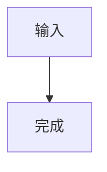

# 03 · 富内容格式与可视化

审计日期：2026-10-24。移动端基准：`4c54cba3`；本章逐行检查的桌面工作树基准：`60f87010`。本章检查消息正文的 Markdown、数学、Mermaid、SVG/MathML、代码、图片与媒体，并对独立图表应用划清范围。

**范围提醒：`60f87010` 不是截至本次审计的远端最新版本。** 主审另行取得远端 `2ba1af33`，已确认新增 `chartEmbedTransform.js`、`chartEmbedHost.js`、`chartEmbedProtocol.js`，把 `vcp-chart` 围栏接入消息。该最新增量由第 07 章详审；本章关于“本地消息尚无原生 chart 围栏”的结论只适用于 `60f87010`，不得用于否定远端新增能力。

## 1. 结论与阅读方式

两端都已具有 Markdown、KaTeX、Mermaid、SVG/MathML、代码高亮和媒体内容承载链。当前差异不等于“桌面拥有这些库，移动端全部缺失”。真正需要区分的是输入语法、生产消费者、互动方式和同步后的降级行为。

这次确认的本地差异主要有：

1. 桌面 Markdown 已有 GFM 任务列表，并保留表格对齐元数据和有序列表起点；移动正文 Rust AST 未启用任务列表，且列表/表格 DTO 会丢掉起始编号与对齐信息。桌面默认表格 CSS 又统一左对齐，因此“保留对齐元数据”不等于已取得正确视觉对齐的 UI 证据。
2. 桌面接受 `mermaid`、`graph`、`flowchart` 三种围栏标签；移动正文的图表特判只有精确的 `mermaid`。移动本身已有更适合触屏的全屏缩放、复制源码/SVG、导出 PNG，不宜再造桌面鼠标工具条。
3. 桌面单美元数学有显式“公式与价格”判断；移动用 pulldown-cmark 的数学语法和自有 LaTeX 预处理。两端都有公式支持，但识别规则不是同一份契约。
4. 桌面 2026-10-01 新增代码块副屏查看；2026-10-04 新增统一媒体生命周期清理。其余一些看起来新颖的功能，如 Mermaid 工具条、SVG 缩进修复、音频自定义控件，历史早于这两项，不能统称“本轮新增”。
5. 桌面附件音视频可在消息中播放；移动音视频附件是文件卡片，经 `open_file` 走原生打开。正文中的 `<audio>/<video>` 又是另一条保留 raw HTML 的路径，不能混为一谈。
6. 本地两端均未确认正式脚注、文献引用编号系统。桌面 bundled Marked 对 `[^1]` 的探针结果甚至是普通 reference link，而非脚注；“能看见上标样的文本”不构成脚注支持。

证据等级：**源码确认**表示已经追到真实生产装配和消费者；**局部执行**表示只执行独立库/解析器，未启动 Electron、WebView 或设备；**待运行验证**表示没有把源码推断冒充真实设备结果。报告未改生产代码，未运行桌面客户端、移动端或发布流程。

## 2. 两条实际生产链

### 2.1 桌面正文

`renderer.js` 创建 `marked.Marked({ gfm: true, breaks: true, ... })`，传入消息渲染器。完整正文先经过内容预处理，再保护 LaTeX、调用 Marked、恢复 LaTeX/工具结果，最后挂载 DOM 并做 KaTeX、代码高亮、Mermaid 等后处理。`main.html` 确实载入本地 KaTeX、Marked、highlight.js 与 Mermaid，结论并非来自 package.json 猜测。

核心入口：

- [Marked 实例与选项](E:/VCPChat/renderer.js:1266)。
- [完整内容预处理的实际顺序](E:/VCPChat/modules/renderer/contentPipeline.js:458)。
- [预处理 → 数学保护 → Marked → 恢复](E:/VCPChat/modules/messageRenderer.js:2006)。
- [正文/附件装配后执行音频、KaTeX、Mermaid](E:/VCPChat/modules/messageRenderer.js:3702)。
- [真实脚本装配](E:/VCPChat/main.html:83)。

注意：工具、Thought、Diary 等有自己的保护与恢复步骤，不能把正文支持集合无条件套到所有嵌套区域。例如 `contentPipeline.js:466` 先隔离 Thought，其注释与顺序明确阻止外层 Mermaid/工具等协议进入思维链。各特殊块详见专项相邻章节。

### 2.2 移动正文

Rust 的 `markdown_parser.rs` 构建 AST，稳定正文通过 `astRenderer.ts` 输出 HTML，活动尾部通过 `astExecutor.ts` 及 DOM Engine 更新。`MessageRenderer.vue` 消费稳定区后才为其渲染 KaTeX/Mermaid；代码高亮由 Rust syntect 完成，流式代码另有增量高亮状态。

核心入口：

- [Rust Markdown 选项及 AST 生产](E:/VCPMobile/src-tauri/src/vcp_modules/chat/pre_renderer/markdown_parser.rs:848)。
- [MessageRenderer 消费稳定 AST](E:/VCPMobile/src/features/chat/MessageRenderer.vue:376)。
- [稳定 HTML 构造](E:/VCPMobile/src/core/utils/astRenderer.ts:234)。
- [增量 AST DOM 构造](E:/VCPMobile/src/core/utils/astExecutor.ts:276)。
- [稳定区域的 KaTeX 与 Mermaid 后处理](E:/VCPMobile/src/features/chat/MessageRenderer.vue:538)。

因此，移动仓库另有 `safeMarkdown.ts` 使用 Marked，并不意味着聊天正文已经等价采用桌面 GFM；它不能覆盖 Rust AST 的实际选项和字段。

## 3. 支持与差异矩阵

下表中的“桌面”均指本地 `60f87010`；最新 `vcp-chart` 单独列明。

| 内容/交互 | 桌面当前生产链 | 移动当前生产链 | 结论与主要证据 |
|---|---|---|---|
| 标题、段落、粗体、斜体、列表、引用块、分隔线、代码 | Marked 解析 | pulldown → AST → HTML/DOM | 两端有。桌面入口 `renderer.js:1266`；移动 `markdown_parser.rs:1120` |
| 单换行 | `breaks: true` | SoftBreak/HardBreak 都转 Break | 两端主动保留为换行；移动 `markdown_parser.rs:1033` |
| 删除线 `~~…~~` | GFM，局部执行确认 `<del>` | `ENABLE_STRIKETHROUGH` + AST | 两端有；移动 `markdown_parser.rs:862`、`:1186` |
| Markdown 表格 | Marked `<table>` | Table AST + 横向可滚动外壳 | 两端有；移动 `markdown_parser.rs:1317` |
| 表格 `:---` / `---:` 对齐 | Marked 发出 `align`，局部执行确认；生产默认 CSS 又统一左对齐 | `Tag::Table(_)` 舍弃对齐；两条前端构造链均无对齐字段 | 结构信息保留存在差异，不能宣称桌面视觉已完全遵循；桌面 `styles/messageRenderer.css:1354`；移动 `markdown_parser.rs:1149`、`astRenderer.ts:274`、`astExecutor.ts:332` |
| 有序列表非 1 起点 | Marked 发出 `<ol start="7">`，局部执行确认 | `Tag::List(start)` 只保存 `start.is_some()`；最终仅 `<ol>` | 移动编号起点丢失；`markdown_parser.rs:1142`、`astRenderer.ts:266`、`astExecutor.ts:315` |
| 任务列表 `- [x]` | GFM 渲染 disabled checkbox，局部执行确认 | 选项没有 `ENABLE_TASKLISTS`，AST 没有任务状态消费者 | 移动正文不具备桌面 checkbox 语义；不是复选框业务编辑功能 |
| 标准 inline/reference Markdown 链接 | Marked | pulldown Link + URL guard | 两端有；移动 `markdown_parser.rs:1158`、`astRenderer.ts:317` |
| 裸 URL 自动识别 | bundled Marked 局部执行确认 | 本章未执行移动 parser 针对裸 URL 的样例 | 桌面确认；移动不因“支持链接”推定裸 URL 等价 |
| 脚注 `[^n]` / `[^n]:` | 未发现脚注扩展；局部执行落到普通 reference link | 未启用 `ENABLE_FOOTNOTES`，AST 无脚注节点 | 两端不计入正式支持。注意原文可能被普通 Markdown 规则误解释 |
| 学术引用、文献编号管理 | 未发现 citation 专用生产消费者 | 未发现 citation 专用生产消费者 | 不因工具返回来源文本/普通链接而宣称已有文献系统 |
| 消息锚点引用 | 本章未确认统一专用引用语法 | `a[href^="#msg-"]` 跳至当前已加载消息 | 移动已有事件消费者；`useMessageEvents.ts:100`；不等于脚注 |
| 引号着色、`@` / `@!` 文本高亮 | DOM TreeWalker + pattern spans | Rust magic/quote 合并 + custom AST | 两端有，非来源引用；桌面 `contentProcessor.js:435`；移动 `markdown_parser.rs:1367`、`:1587` |
| `$…$` 行内公式 | 带词法/长度/价格边界保护后转 `\(…\)` | pulldown math | 两端有，但识别边界不同；详 §4 |
| `$$…$$`、`\[…\]`、`\(…\)` | 保护 → KaTeX auto-render | 反斜杠格式归一到美元格式 → Math AST → KaTeX | 两端有；复杂输入需跨端样例核对 |
| `mermaid` 围栏 | 预处理为 placeholder → Mermaid | 精确 lang 判定 → placeholder → Mermaid | 两端有 |
| `graph` / `flowchart` 围栏标签 | 同样转换为 Mermaid placeholder | 精确判定只有 `mermaid`，其他按代码 | 移动确有别名差异；正文必须仍是合法 Mermaid 源码 |
| Mermaid 视图交互 | 气泡内缩放、适宽、拖移、滚轮、双击重置 | 点击稳定图表打开全屏；拖移/捏合、复制源码/SVG、PNG 导出 | 移动已有独立成熟路径，不应直接照搬桌面鼠标 UI |
| raw SVG / MathML | 内嵌 HTML 进入 DOM；另有缩进修复 | raw HTML 经 guard 保留 SVG/MathML 节点 | 两端可承载；不等于任意 SVG/MathML 字符串/围栏都自动绘图 |
| `svg` 围栏 | 普通代码；HTML 预览检测未特判 svg | 普通 CodeBlock；预览只特判 html | 不要把 raw `<svg>`、SVG 附件和 `svg` fence 合并为一种能力 |
| ECharts/Chart.js 等任意 JS 图表 | 可通过 HTML/独立图表运行时承载；本地无专用消息图表 fence 消费者 | 可走 HTML 预览，未有相同图表持久化协议 | HTML 通用运行能力与原生消息格式必须分开登记 |
| 本地 Chartmodules 工作台 | `chartAPI`、持久化 snapshot、独立 runtime/iframe、悬浮展示 | 未确认对应工作台 | 属独立图表产品；详 §7 |
| 最新 `vcp-chart` 消息内嵌 | **远端 `2ba1af33` 新增，超出本章本地基准** | 未接入该协议 | 最新增量以第 07 章为准，不受上一行限制 |
| 图片 Markdown / `` | 图片点击独立 viewer，右键图片菜单 | 图片事件桥统一处理 `img,image,svg,canvas`，打开移动 viewer | 两端有，但交互面不同 |
| 音视频 HTML | 保留媒体元素，统一 controls/metadata、禁 autoplay/loop；音频增强 UI | raw HTML guard 保留媒体元素，浏览器按内容和环境执行 | 支持面存在；不可声称已验证所有编码/跨域/后台播放 |
| 音视频附件 | 消息中创建 `<audio controls>` / `<video controls>` | 文件卡片点击 `open_file`，走移动原生打开链 | 产品行为有意不同；不应把外部打开写成“不能使用音视频” |
| 代码语法高亮 | highlight.js `highlightElement` | Rust syntect，含流式完整行/活跃行增量 | 都有；语言集合和未知语言回退不同 |
| 代码副屏查看 | >4 行普通代码块经 contribution 命令打开 code-viewer tab | 未发现对应副屏功能 | 桌面新增，移动不应引入桌面平台业务分支 |

## 4. 数学：不是简单的“支持 KaTeX”

桌面主链在 Markdown 前保护公式，避免下划线、反斜杠被当作 Markdown。当前保护器会先保护代码围栏，包括未闭合围栏，然后依次处理独占行 `$$`、`\[\]`、`\(\)` 和安全的单美元公式；单美元内容最多 1200 字符，不跨行，不跨 HTML 标签。价格候选不安全时只释放开头 `$`，继续扫描后续真正的公式。

桌面单美元允许简单标识符、纯数值以及显式数学信号；排除开头为 `/` 的路径、完整 `{…}` 模板式内容、含 `|` 的跨表格候选。DOM 后处理再次做单文本节点归一，KaTeX auto-render 本身**不注册宽松的 `$…$` 分隔符**。这是显式产品容错逻辑，不能用“全开 auto-render”替换。证据：[预保护器](E:/VCPChat/modules/messageRenderer.js:189)、[单美元规则](E:/VCPChat/modules/messageRenderer.js:200)、[独占行块公式](E:/VCPChat/modules/messageRenderer.js:365)、[DOM 规范化与最终 KaTeX](E:/VCPChat/modules/renderer/contentProcessor.js:1185)。

移动端在 [preprocess_latex_math](E:/VCPMobile/src-tauri/src/vcp_modules/chat/pre_renderer/markdown_parser.rs:504) 将 `\[…\]` / `\(…\)` 转为 `$$…$$` / `$…$`，并在 [strip_display_math_indent](E:/VCPMobile/src-tauri/src/vcp_modules/chat/pre_renderer/markdown_parser.rs:483) 去除会触发代码块的显示数学缩进；围栏区间会受保护。pulldown 输出 InlineMath/DisplayMath，再由 [MessageRenderer](E:/VCPMobile/src/features/chat/MessageRenderer.vue:562) 用 `throwOnError:false, strict:false` 渲染。

源码可以确认两端都处理四类常见分隔符，不能据此断言价格、跨标签、过长公式、表格内 `$`、未闭合围栏的行为一致。尤其桌面明确排除单美元候选内部的 `|`，会与需要竖线的公式写法形成识别差异；不能把其启发式理解为完整 TeX 语法定义。

本次独立加载了桌面实际 `vendor/katex.min.js`，其 `version` 返回 `0.16.9`；移动 package.json 声明的是 `^0.18.10`。这进一步说明两端并非同一版本实现，但本章没有以版本号推断完整的命令兼容清单。

## 5. Mermaid：格式别名、容错与交互

桌面 [contentTransforms.js](E:/VCPChat/modules/chat/contentTransforms.js:14) 正则接受三种围栏 info string，大小写不敏感：`mermaid`、`flowchart`、`graph`；也识别 `<code>` 内以这些词开头的特殊形式。后者匹配的是 code 的**文本前缀**，不是所有 `code.language-mermaid` 的一般规则。

三种 fence label 只是路由别名，正文仍必须是合法 Mermaid 代码。例如 `graph` 围栏内写 `graph TD; A-->B` 才有完整 diagram 声明，不能误以为 fence label 自动补成正文首行。桌面会在真正渲染前将 `—/–/－` 替换为 `--`；逐图处理，单图失败显示错误及原始代码，避免一张错误图阻止其他图。[渲染与容错](E:/VCPChat/modules/messageRenderer.js:620)。

移动稳定/活动 AST 只有 `node.lang === 'mermaid'` 特判；Rust 同样对精确 `mermaid` 跳过 syntect，因此 `graph`、`flowchart`、`Mermaid` 都不能直接认定与桌面等价。需要同时考虑 AST、稳定 HTML、增量高亮以及图表消费入口，不能只改一个正则。[稳定路径](E:/VCPMobile/src/core/utils/astRenderer.ts:243)、[活动路径](E:/VCPMobile/src/core/utils/astExecutor.ts:276)、[Rust 终态代码节点](E:/VCPMobile/src-tauri/src/vcp_modules/chat/pre_renderer/markdown_parser.rs:131)。

移动自身已有值得保留的实现：

- [共享渲染器](E:/VCPMobile/src/features/chat/utils/mermaidRenderer.ts:1) 串行执行 Mermaid、合并相同待渲染任务，按 source/theme/options 缓存模板；总缓存上限 4 MiB，单项上限 512 KiB，订阅者可取消。
- [实例化 SVG](E:/VCPMobile/src/features/chat/utils/mermaidRenderer.ts:104) 为每个 DOM 消费者重写 ID 及引用，避免复用 SVG 模板后跨图 ID 冲突。
- [消息事件桥](E:/VCPMobile/src/core/composables/useMessageEvents.ts:35) 仅允许稳定区已出 SVG 的图进入全屏；[全屏 viewer](E:/VCPMobile/src/features/chat/blocks/MermaidFullScreenViewer.vue:97) 支持拖移/捏合，[复制](E:/VCPMobile/src/features/chat/blocks/MermaidFullScreenViewer.vue:195) 和 [PNG 导出](E:/VCPMobile/src/features/chat/blocks/MermaidFullScreenViewer.vue:226) 已存在。

桌面当前工具条主要针对鼠标：缩放、100%、适宽、滚轮、pointer 拖移、双击重置。[工具条](E:/VCPChat/modules/messageRenderer.js:689)、[交互处理](E:/VCPChat/modules/messageRenderer.js:730)。它不能作为“移动缺乏图表交互”的依据。

## 6. SVG、MathML、代码与 Markdown 保真

### 6.1 SVG/MathML 是 raw HTML 能力，不是独立插件名

桌面 `deIndentMisinterpretedCodeBlocks` 已从标签白名单改成通用 HTML/XML 起始检测，专门避免 `<g>`、`<path>`、`<linearGradient>`、MathML 等缩进行被误作 Markdown 缩进代码块。围栏内不做此变换，列表项也保留原语义。[代码](E:/VCPChat/modules/renderer/contentProcessor.js:1426)。

移动 raw HTML 经 [filterTrustedRichHtml](E:/VCPMobile/src/core/utils/astRenderer.ts:107) 进入 DOM；其主动文档标签名单中不含 SVG/MathML，正常节点、布局、样式和被动媒体保留，宿主调用等主动入口另行受限。raw SVG、MathML 因而是现有富 HTML 能力，不能因为“不是专用 Vue 组件”就判为不支持。详细主动执行边界由 HTML/沙箱专项分析。

普通 `svg` fence 则是源码展示。桌面仅在 `language-html` 或内容以 `<!DOCTYPE html>`/`<html` 开头时安装 HTML 预览；移动内容解析只对 `html`（忽略大小写）生成 HtmlPreview。证据：[桌面 pre 后处理](E:/VCPChat/modules/renderer/contentProcessor.js:719)、[移动 fence 分流](E:/VCPMobile/src-tauri/src/vcp_modules/chat/content_parser.rs:639)。

### 6.2 代码高亮的真实集合与回退

桌面主内容后处理对一般 `pre code` 调 `hljs.highlightElement`，工具/日记专门美化的块排除在外。[高亮入口](E:/VCPChat/modules/renderer/contentProcessor.js:1281)。本次以 Node 独立加载实际 bundled `vendor/highlight.min.js`，得到版本 `11.9.0`，36 个已注册语言：

```text
bash, c, cpp, csharp, css, diff, go, graphql, ini, java,
javascript, json, kotlin, less, lua, makefile, markdown, objectivec,
perl, php, php-template, plaintext, python, python-repl, r, ruby,
rust, scss, shell, sql, swift, typescript, vbnet, wasm, xml, yaml
```

同次 `getLanguage()` 局部执行：`js/ts/py/sh/bash/shell/rust/rs/tsx/jsx/json/md` 返回可识别；补充查询 `html/xml` 也返回可识别；`zsh/vue/mermaid/graph/flowchart/math/latex` 返回不可识别。此处只是**高亮语言注册**：Mermaid 经独立转换仍能绘图，`html` 可高亮或进入 HTML 预览，不能把“未注册高亮语言”改写成“内容被拒绝”。

移动使用 syntect 默认语法集，实际 [syntax_for_language](E:/VCPMobile/src-tauri/src/vcp_modules/chat/pre_renderer/code_highlighter.rs:131) 按小写 token、原 token、原扩展名查询；未知语言回退 **JavaScript**，再退纯文本。故不能用桌面 highlight.js 的别名表直接定义移动支持表，更不能假定未知语言总是纯文本。流式高亮把完整行与活跃行分开，并保留 ParseState/ScopeStack；不是前端反复扫描完整代码。[状态与增量策略](E:/VCPMobile/src-tauri/src/vcp_modules/chat/pre_renderer/code_highlighter.rs:20)。

### 6.3 新增副屏入口的适用范围

桌面普通代码块超过 4 行才安装“副屏”和“复制”按钮；工具结果/请求/日记等内部块跳过。副屏调用 `VCPContributions.commands.execute('sidepane.open-tab', { kind:'code-viewer', payload:{ code, language, mode:'view' } })`，同段代码以 hash/长度构造 tab identity，从而重复点击回到已有标签。[完整安装逻辑](E:/VCPChat/modules/renderer/contentProcessor.js:592)。

移动常规代码块当前没有同名副屏消费者。它是交互功能差异，不是高亮缺失；若后续决定吸收，应先决定手机上的查看/复制体验，不照搬桌面多栏工作区。

### 6.4 Markdown 中确实会丢失的结构信息

移动 `Tag::List(start)` 在 AST 构造时只保留“是否有序”，表格对齐也在 `Tag::Table(_)` 时舍弃；因此后面再优化 CSS 不会恢复原文中的起始编号或对齐。稳定 HTML 和活动 DOM 两条路径都确认缺这些字段，属于明确的信息丢失。任务列表则是 parser 选项未启用，不能仅用 CSS 画 checkbox 假装已经解析。

桌面需要额外区分语义与视觉：Marked 保留 `align`，但 [实际样式](E:/VCPChat/styles/messageRenderer.css:1354) 为 `.md-content th, .md-content td` 指定 `text-align:left`，并由 [style.css](E:/VCPChat/style.css:15) 加载。局部 parser 输出不足以证明最终列对齐已正确显示。本章将它登记为“结构元数据差异”，不把桌面样式表现当作移动的目标断言。

以上是当前行为事实，尚非用户批准的实现清单。对于同步来的桌面 Markdown，它们比重新移植已经存在的 KaTeX/Mermaid 更值得先评估。

## 7. Chartmodules 与消息图表应分版本记录

本地 `60f87010` 的独立图表链已经存在：

- [main.js 装配 chartHandlers](E:/VCPChat/main.js:109)。
- [chart.html 的工作台/iframe 和 runtime 脚本](E:/VCPChat/Chartmodules/chart.html:63)。
- [工作台建立 VCPChartRuntime](E:/VCPChat/Chartmodules/chart.js:325)。
- [按 chartId 读取 snapshot 并加载](E:/VCPChat/Chartmodules/chart.js:389)。
- [独立展示/回收](E:/VCPChat/Chartmodules/chart.js:293)。

它有列表、选择、持久化图表 snapshot、修改事件、悬浮展示、Canvas 编辑等独立产品入口。与此同时，本地消息 `contentPipeline.js` 中图表预处理是 Mermaid，`contentProcessor.js` 的 code-block 特判是工具/日记/HTML，没有该工作台对应的消息图表 fence 协议。因此本地的正确表述是“已有独立图表应用，消息可通过 Mermaid 或通用 HTML 表达图表”，不是“消息原生支持所有 chart 代码块”。

**这个结论在远端最新版本有新增层。** 主审确认远端 `2ba1af33` 增加 `vcp-chart` 消息内嵌链。完整报告应同时保留“独立图表工作台”和“消息内 chart embed”两项，按提交区分；最新接入、参数、生命周期、移动兼容与同步依赖见第 07 章。本章不拿本地缺少文件作为全仓最新能力的否定证据。

## 8. 图片、音视频与附件

桌面图片是实际 `` 节点，主链通过 [imageHandler](E:/VCPChat/modules/renderer/imageHandler.js:33) 挂图片查看与右键菜单，并处理表情包 URL。移动 [useMessageEvents](E:/VCPMobile/src/core/composables/useMessageEvents.ts:111) 已覆盖 `img,image,svg,canvas`，经现有图片 payload/preview owner 打开；并非只有 Markdown 图片才能查看。

桌面 [renderAttachments](E:/VCPChat/modules/messageRenderer.js:3524) 按 MIME 分为 image/audio/video/普通文件；audio/video 直接创建带 controls 的媒体元素。之后 [enhanceAudioPlayers](E:/VCPChat/modules/messageRenderer.js:3311) 对原生 audio 叠加播放、进度、音量、静音、下载、错误反馈；开始播放会暂停同一消息面其他增强 audio，卸载释放事件/播放/source。[互斥播放与清理](E:/VCPChat/modules/messageRenderer.js:3443)。

2026-10-04 的 [mediaLifecycle.js](E:/VCPChat/modules/renderer/mediaLifecycle.js:1) 更值得作为近期变化记录：HTML 挂载前在 inert template 中移除 autoplay/loop、设 metadata/controls；卸载时 pause、清空 srcObject/src/source/track 并 load 释放。它覆盖正文 HTML 媒体和附件，与原先仅增加好看的播放器有不同价值。

移动附件的真实行为由 [AttachmentPreview.openViewer](E:/VCPMobile/src/features/chat/attachment/AttachmentPreview.vue:57) 决定：图片和文本在应用 viewer，重型文档、音视频等执行 `open_file`；不能因为 `AudioAttachment.vue` 有音频图标就称它为音频播放器。原生不能预览时显示保留文件、分享、导出的后续动作。[原生调用](E:/VCPMobile/src/features/chat/attachment/AttachmentPreview.vue:93)、[回退呈现](E:/VCPMobile/src/features/chat/attachment/AttachmentPreview.vue:178)。

移动 raw HTML 中 `<audio controls>`/`<video controls>` 是保留的 HTML，不通过附件卡片这一支。本章没有验证其编码、远程鉴权、跨域、自动播放策略、后台/恢复行为，也不从节点存在推断全媒体兼容。

## 9. 历史定位：新能力与旧能力增强

以下历史来自本地 Git log/blame。blame 指当前存活行的归属，可证明相应行为在该提交存在，不单独证明整个特性的首次发明时间；“自移动流式实现后”的严格基线由报告总览/历史章节统一确定。

| 日期 | 提交 | 本章能定位到的变化 | 归类 |
|---|---|---|---|
| 2026-06-11～06-12 | `b4241ee9`、`b74b868d`、`2bf3f284` | 安全单美元公式判定、数值/价格规则与 DOM 规范化 | 数学识别增强；不是新增 KaTeX 引擎 |
| 2026-06-13 | `2283e7d2` | 当前 Mermaid 查看器缩放/重置/适宽工具条主要存活行 | 已存在的图表交互 |
| 2026-06-15 | `aa23a050` | SVG/MathML/自定义标签缩进修正采用通用标签检测 | raw HTML 保真修复 |
| 2026-06-16 | `7c5665d2` | 相邻中文/引号粗体边界归一 | Markdown 容错增强 |
| 2026-07-24～07-26 | `4b73a719`、`3f14e938` | 数学不跨 HTML 元素配美元、闭合简单标识符支持 | 数学识别继续增强 |
| 2026-07-30 | `21deb243` | 当前自定义音频控件主要存活行 | 媒体交互已存在 |
| 2026-08-30 | `404b2e6c` | `contentTransforms` 及 Mermaid 相关历史标注“fix mermaid竞态” | 生命周期/竞态修复，不直接等同新增图形语法 |
| 2026-09-18 | `9be5b19e` | “上架v图表系统”，Chartmodules 出现在该功能历史 | 独立图表产品新增 |
| 2026-10-01 | `7fd55302` | “Side pane: notes and code viewer tabs” | 代码副屏新增 |
| 2026-10-04 | `3561d654` | “增强多媒体生命周期管理”，新增 mediaLifecycle | 媒体播放/释放边界增强 |
| 2026-10-07 | `4575f0b5` | “Main chat code blocks: keep the side view button clickable” | 副屏按钮可点击性修复 |
| 最新远端 | `2ba1af33` | 主审确认 `vcp-chart` 消息 embed 三个生产模块 | 最新消息能力新增，详第 07 章 |

## 10. 可复核样例与证据边界

下面是后续对照时可直接使用的输入。除明确写为“局部执行”外，结果依据生产源码，未声称取得两端 UI 截图或设备操作证据。

### A. 同一输入检查结构信息

```markdown
7. 第七项
8. 第八项

- [x] 已完成
- [ ] 待处理

| 左 | 右 |
|:---|---:|
|甲|乙|

正文[^n]

[^n]: 注释正文
```

桌面 bundled Marked 局部执行：列表输出 `start="7"`；任务项为 disabled checkbox；单元格发出左右 `align`；脚注输入输出普通 reference link，href 指向经编码的“注释正文”。移动源码：列表起点/对齐无字段保存，任务和脚注未启用。最后一项必须避免被写成“桌面脚注已支持”。

### B. Mermaid 别名

````markdown


```graph
graph TD
  A[输入] --> B[完成]
```

```flowchart
flowchart LR
  A --> B
```
````

桌面三种标签均有实际转换；移动特判只有第一种。样例正文保留合法 diagram 首行，避免将别名路由测试变成 Mermaid 语法错误测试。

### C. 数学与价格并存

```text
价格 $12.50，另一件 $8.20。变量 $x$，复杂度 $O(n^2)$。
行内 \(a_b+c\)；显示式：
$$
\begin{matrix}a&b\\c&d\end{matrix}
$$
模板 ${value}；路径 $/tmp$；绝对值 $|x|$。
```

用于比较两端识别差异，而不是预设都渲染。桌面显式排除含 `|` 的单美元候选，并保护价格/路径/模板边界；移动走 pulldown 数学语义，需实际样例验证差异再决定是否统一。

### D. raw 图形、源码图形与媒体

````html
<svg xmlns="http://www.w3.org/2000/svg" width="160" height="80" viewBox="0 0 160 80">
  <circle cx="40" cy="40" r="20" fill="currentColor"/>
</svg>
<math xmlns="http://www.w3.org/1998/Math/MathML"><mfrac><mn>1</mn><mn>2</mn></mfrac></math>
<audio controls src="https://example.org/sample.mp3"></audio>
<video controls src="https://example.org/sample.mp4"></video>
````

这里的 URL 只作语法样例，不代表可用媒体资源。将同一 SVG 放进 `svg` fence 应按源码对照，不能期待自动转换为图形。媒体核验应使用确实可访问、已知编码的受控素材，并区分正文 HTML 与消息附件。

### 本次已执行的最小核验

在 `E:\VCPChat` 通过 Node 直接 require 本地 `vendor/marked.min.js`、`vendor/highlight.min.js`、`vendor/katex.min.js`，对 Marked 使用主程序的 GFM/breaks 核心选项，读取语言表和版本并解析上述结构样例。未启动桌面入口、未访问样例 URL、未写入桌面文件。该执行只验证独立库输出；生产装配、后处理和移动对照分别由前述源码支持，未用局部探针代替完整 UI 验收。

本章仅新增报告，未修改业务代码，未新增约束性测试，也未运行 `pnpm check` 或平台构建；这些不能为纯源码调研补充实际设备结论。
