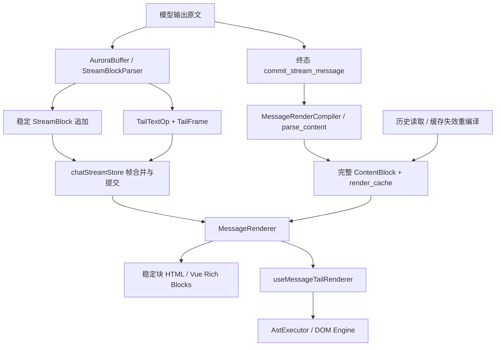
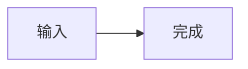

# 06｜移动端支持基线与验证清单

审计日期：2026-10-24（Asia/Shanghai）。移动端源码基线：`4c54cba3c3ac4eb90a309acc4b7e17e3354d27e4`。本文仅审计当前生产调用链并提出验证清单，未修改生产代码，未运行构建、测试或设备操作。仓库原有未跟踪目录 `plan/vcpmobile-pele-streaming-research/` 不在本次写入范围内。

本文中的“已有”指在当前代码中能够追踪到生产入口、数据结构及消费端；不等于本次取得了 Android 真机或 Apple 构建结果。桌面新增时间和两端差异以本专项其他分报告为准，不能用本文能力表倒推出桌面的引入时间。

## 1. 先明确比较对象

移动端已经具备 Markdown、流式代码高亮、KaTeX、Mermaid、SVG/MathML、受控 raw HTML、可执行 HTML 文档沙箱、消息 CSS、工具调用与结果、工具摘要、思维链、日记创建/更新、按钮回传、气泡分割、图片预览及资源生命周期处理。后续对齐应比较**同一种输入的识别方式、执行边界、流中时机和交互结果**，不能仅按桌面文件名或依赖名判断“移动端没有”。

尤其要分开三种能力：

1. **专门语法支持**：例如 `mermaid` 围栏被识别为图表，由应用加载 Mermaid、渲染 SVG，并提供全屏入口。
2. **宿主中的富 HTML**：正文 raw HTML 经过 `filterTrustedRichHtml`，允许丰富结构、样式和部分局部 DOM 事件；直接 `<script>` 被去掉。
3. **完整 HTML 预览**：`html` 围栏或 HTML 文档进入 `HtmlPreviewBlock`，保留脚本，在 `sandbox="allow-scripts"` 的不透明来源 iframe 中执行。某个图表库能在完整文档里自行加载，不代表移动端已经有它的专门围栏渲染器；没有专门围栏也不能推导出完整 HTML 无法画图。

“sanitizer”还需区分用途：Rust `context_sanitizer.rs` 是送给模型的 HTML→Markdown 上下文投影，不是界面 DOM 安全边界；消息界面的主动内容限制在 TypeScript，完整 HTML 的执行隔离在 iframe。参见 [context_sanitizer.rs:1](../../src-tauri/src/vcp_modules/chat/context_sanitizer.rs)、[astRenderer.ts:25](../../src/core/utils/astRenderer.ts)、[HtmlPreviewBlock.vue:78](../../src/features/chat/blocks/HtmlPreviewBlock.vue)。

## 2. 从生产入口恢复的渲染链



### 2.1 流中

- `StreamBlockParser::process` 切分已闭合稳定块与未闭合 tail；语法标记主要按行首识别，代码围栏保护协议示例不被误切。入口见 [stream_block_parser.rs:320](../../src-tauri/src/vcp_modules/chat/stream_block_parser.rs)，标记定义见 [content_parser.rs:342](../../src-tauri/src/vcp_modules/chat/content_parser.rs)。
- `AuroraUpdate` 区分 snapshot 与 delta，稳定追加携 `base_count`，tail 用 append/replace/clear 投影，AST 帧携 `streamId/epoch/revision/frameSeq`。正常更新不携全量消息正文；见 [aurora_pipeline.rs:37](../../src-tauri/src/vcp_modules/chat/aurora_pipeline.rs)、[aurora_pipeline.rs:75](../../src-tauri/src/vcp_modules/chat/aurora_pipeline.rs)、[aurora_pipeline.rs:105](../../src-tauri/src/vcp_modules/chat/aurora_pipeline.rs)。
- `chatStreamStore` 管理接收、合并和渲染提交；消息组件的 `useMessageTailRenderer` 单独维护 DOM 已应用帧水位。更换流、epoch、沙箱重挂载或补丁失败需要快照恢复，重复恢复失败才退出 AST 模式。不能把 Store 收到帧等同于 DOM 已画完。见 [chatStreamStore.ts:166](../../src/core/stores/chatStreamStore.ts)、[useMessageTailRenderer.ts:25](../../src/features/chat/composables/useMessageTailRenderer.ts)、[useMessageTailRenderer.ts:156](../../src/features/chat/composables/useMessageTailRenderer.ts)。
- 稳定气泡投影与 tail 分开计算；气泡分割不重置整条消息的 tail 生命周期。见 [MessageRenderer.vue:260](../../src/features/chat/MessageRenderer.vue)。

### 2.2 完成、停止与历史

- durable 终态从完整原文重新编译：`commit_stream_message` → `compile_and_serialize_render_async` → `MessageRenderCompiler::compile` → `parse_content`。见 [message_service.rs:1617](../../src-tauri/src/vcp_modules/chat/message_service.rs)、[message_repository.rs:78](../../src-tauri/src/vcp_modules/persistence/message_repository.rs)、[message_repository.rs:153](../../src-tauri/src/vcp_modules/persistence/message_repository.rs)。
- 终态完整 blocks 接管当前展示；终态编译失败时保留已经收到的 tail，避免把已有内容清空。见 [chatStreamStore.ts:366](../../src/core/stores/chatStreamStore.ts)、[chatStreamStore.ts:1327](../../src/core/stores/chatStreamStore.ts)、[MessageRenderer.vue:161](../../src/features/chat/MessageRenderer.vue)。
- 历史命中本地 `render_cache` 要求原文 hash、renderer schema 和压缩载荷同时有效；未命中从原文重编译，按原文 hash 做 CAS 回写，防止慢结果覆盖新编辑。当前 schema 为 2。见 [message_service.rs:281](../../src-tauri/src/vcp_modules/chat/message_service.rs)、[message_service.rs:1362](../../src-tauri/src/vcp_modules/chat/message_service.rs)、[message_repository.rs:14](../../src-tauri/src/vcp_modules/persistence/message_repository.rs)、[message_repository.rs:103](../../src-tauri/src/vcp_modules/persistence/message_repository.rs)。
- 编译和序列化经过最多 1–4 个并发许可的 blocking worker；缓存为 JSON + zstd，解压上限 16 MiB。该上限是缓存读取边界，不能当作“所有消息最大 16 MiB”的产品定义。见 [message_repository.rs:47](../../src-tauri/src/vcp_modules/persistence/message_repository.rs)、[message_repository.rs:163](../../src-tauri/src/vcp_modules/persistence/message_repository.rs)。
- 流式分块与终态分块/hash 不是同一表示，不要求逐项相等。`StreamBlockParser::finalize` 对残留未闭合 tail 仍有自己的收尾逻辑；durable 终态的完整编译不能被它替代。见 [stream_block_parser.rs:538](../../src-tauri/src/vcp_modules/chat/stream_block_parser.rs)。

## 3. 全量能力基线

表中的“完成/历史”指完整编译后由相同展示消费者处理；历史仍受缓存有效性影响。

| 编号 | 输入/能力 | 当前移动端实现 | 流中与完成/历史的区别 | 关键源码 |
|---|---|---|---|---|
| M01 | 标题、段落、粗体、斜体、删除线、引用、列表、表格、链接、图片、分隔线、行内代码 | Rust pulldown 产出块/行内 AST，前端静态 HTML 与 tail DOM 两条消费路径 | tail AST 增量；沉淀后 HTML 缓存按消息 ID + block hash；软换行与硬换行均转 `<br>` | [markdown_ast.rs:6](../../src-tauri/src/vcp_modules/chat/pre_renderer/markdown_ast.rs)、[markdown_parser.rs:860](../../src-tauri/src/vcp_modules/chat/pre_renderer/markdown_parser.rs)、[astRenderer.ts:207](../../src/core/utils/astRenderer.ts) |
| M02 | `$…$`、`$$…$$`、`\(…\)`、`\[…\]` 数学 | Rust math 节点；括号形式先归一化；前端 KaTeX 生成视觉结果 | 活动 tail 保留 LaTeX 占位；重型渲染只扫描 stable 区，块沉淀即可渲染，不必等待整条回复结束 | [markdown_parser.rs:504](../../src-tauri/src/vcp_modules/chat/pre_renderer/markdown_parser.rs)、[markdown_parser.rs:909](../../src-tauri/src/vcp_modules/chat/pre_renderer/markdown_parser.rs)、[MessageRenderer.vue:539](../../src/features/chat/MessageRenderer.vue) |
| M03 | 普通代码围栏、嵌套长围栏、流式高亮 | Rust Syntect classed HTML；流中持有语言解析状态，追加完成行、替换活动行 | 完成态重新生成代码块高亮；流中 PatchCode 不重复替换已完成行 | [markdown_parser.rs:96](../../src-tauri/src/vcp_modules/chat/pre_renderer/markdown_parser.rs)、[code_highlighter.rs:28](../../src-tauri/src/vcp_modules/chat/pre_renderer/code_highlighter.rs)、[code-patch-executor.ts:26](../../src/core/dom-engine/executors/code-patch-executor.ts) |
| M04 | `mermaid` 围栏，以及 `.mermaid`、`.mermaid-placeholder`、`code.language-mermaid` | 稳定区异步加载 Mermaid，严格安全级别；生成 SVG，可打开独立全屏查看器 | tail 只是源码占位；稳定块生成图；已有 raw HTML SVG 只增强，不把 SVG 标签误当 Mermaid 源码再次解析 | [astRenderer.ts:5](../../src/core/utils/astRenderer.ts)、[astRenderer.ts:244](../../src/core/utils/astRenderer.ts)、[MessageRenderer.vue:589](../../src/features/chat/MessageRenderer.vue)、[mermaidRenderer.ts:1](../../src/features/chat/utils/mermaidRenderer.ts) |
| M05 | raw HTML、SVG、MathML、表单、媒体、局部事件 | raw HTML 节点经富 HTML 护栏后进入 DOM；没有把 SVG/MathML 整块转成文本 | HTML 容器 tail 可走冻结前沿补丁；终态容器内部还会进行 Markdown 解析；普通 SVG/MathML依靠浏览器 HTML/命名空间解析，不是专门绘图库 | [markdown_parser.rs:1025](../../src-tauri/src/vcp_modules/chat/pre_renderer/markdown_parser.rs)、[astRenderer.ts:107](../../src/core/utils/astRenderer.ts)、[astExecutor.ts:380](../../src/core/utils/astExecutor.ts)、[aurora_pipeline.rs:282](../../src-tauri/src/vcp_modules/chat/aurora_pipeline.rs) |
| M06 | `div/section/article/header/footer/main/aside/figure/figcaption` 内嵌 Markdown | 内容层识别容器，保留开闭标签，对去公共缩进后的内部内容继续解析 | 未闭合容器 tail 以 raw HTML 结构处理，闭合后内部 Markdown 可能发生格式收敛；不能要求流中每一帧与终态视觉完全相同 | [content_parser.rs:369](../../src-tauri/src/vcp_modules/chat/content_parser.rs)、[content_parser.rs:806](../../src-tauri/src/vcp_modules/chat/content_parser.rs)、[stream_block_parser.rs:847](../../src-tauri/src/vcp_modules/chat/stream_block_parser.rs) |
| M07 | 独立 `<style>`、消息级主题样式 | 提取样式并按消息顺序汇总，经 `[data-message-id]` 作用域注入；卸载回收当前实例样式 | stable CSS 独立计算，tail-only 更新不扫描全部 stable AST；fallback tail 另分离 HTML/CSS | [messageStyles.ts:4](../../src/features/chat/utils/messageStyles.ts)、[useMessageStyleInjector.ts:8](../../src/core/composables/useMessageStyleInjector.ts)、[MessageRenderer.vue:926](../../src/features/chat/MessageRenderer.vue) |
| M08 | `html` 围栏、以 `<!DOCTYPE html>` / `<html…>` 开始的完整文档 | `HtmlPreviewBlock` 代码/预览切换、复制、刷新、全屏；脚本保留在 opaque-origin iframe | 默认代码模式；整条消息流式期间禁用执行预览、复制和全屏，源码仍可增量高亮；完成后用户主动打开 | [content_parser.rs:232](../../src-tauri/src/vcp_modules/chat/content_parser.rs)、[stream_block_parser.rs:876](../../src-tauri/src/vcp_modules/chat/stream_block_parser.rs)、[HtmlPreviewBlock.vue:18](../../src/features/chat/blocks/HtmlPreviewBlock.vue)、[HtmlPreviewBlock.vue:199](../../src/features/chat/blocks/HtmlPreviewBlock.vue) |
| M09 | `<<<[TOOL_REQUEST]>>>` / `<<<[END_TOOL_REQUEST]>>>` | 工具名提取、字段定界、独立 ToolBlock；工具请求正文作为等宽内容展示 | 未闭合协议 tail 作为 plaintext 代码节点走增量路径；闭合后工具块；默认折叠策略可设置，本次手动展开优先 | [content_parser.rs:343](../../src-tauri/src/vcp_modules/chat/content_parser.rs)、[content_parser.rs:1019](../../src-tauri/src/vcp_modules/chat/content_parser.rs)、[aurora_pipeline.rs:891](../../src-tauri/src/vcp_modules/chat/aurora_pipeline.rs)、[ToolBlock.vue:45](../../src/features/chat/blocks/ToolBlock.vue) |
| M10 | `[[VCP调用结果信息汇总:` … `VCP调用结果结束]]` | 工具名、状态、键值详情、footer；详情走 marked GFM+breaks → 富 HTML 护栏；可复制/全屏；特定字段的图片 URL/base64 可显示图片 | 未闭合阶段不逐帧当 Markdown 解析；稳定区中符合选择器的 Mermaid 可被消息增强流程发现 | [stream_block_parser.rs:1023](../../src-tauri/src/vcp_modules/chat/stream_block_parser.rs)、[ToolBlock.vue:13](../../src/features/chat/blocks/ToolBlock.vue)、[ToolBlock.vue:135](../../src/features/chat/blocks/ToolBlock.vue) |
| M11 | `[本轮工具调用摘要:]` … `[本轮工具调用摘要结束]` | 独立摘要块，按 success/failure/timeout/rejected/cancelled/skipped/unknown 展示；解析无项时保留原文 | 未闭合协议 tail 封印为代码文本，闭合后摘要块 | [content_parser.rs:375](../../src-tauri/src/vcp_modules/chat/content_parser.rs)、[content_parser.rs:1258](../../src-tauri/src/vcp_modules/chat/content_parser.rs)、[ToolSummaryBlock.vue:8](../../src/features/chat/blocks/ToolSummaryBlock.vue) |
| M12 | VCP 元思考链、`<think>` / `<thinking>` | ThoughtBlock 折叠外壳，支持主题名，闭合内容使用 Markdown AST | 长思维 tail 为 Plain 模式增量正文，不逐帧重跑 Markdown；活跃流默认展开，稳定历史默认折叠；闭合时富文本接管 | [content_parser.rs:349](../../src-tauri/src/vcp_modules/chat/content_parser.rs)、[aurora_pipeline.rs:863](../../src-tauri/src/vcp_modules/chat/aurora_pipeline.rs)、[ThoughtBlock.vue:16](../../src/features/chat/blocks/ThoughtBlock.vue)、[thought-executor.ts](../../src/core/dom-engine/executors/thought-executor.ts) |
| M13 | `<<<DailyNoteStart>>>` 旧日记、DailyNote 工具 create/update | 日记标题、Maid/Valet、日期、文件夹；创建正文 AST；更新前后 A/B 两侧 AST；无需等桌面“日记卡”才能提供这些内容 | DailyNote 工具在闭合后转为日记领域块；不是所有未知 DailyNote 参数都应强行转卡片 | [content_parser.rs:358](../../src-tauri/src/vcp_modules/chat/content_parser.rs)、[content_parser.rs:1172](../../src-tauri/src/vcp_modules/chat/content_parser.rs)、[stream_block_parser.rs:726](../../src-tauri/src/vcp_modules/chat/stream_block_parser.rs)、[DiaryBlock.vue:12](../../src/features/chat/blocks/DiaryBlock.vue) |
| M14 | `<<<[ROLE_DIVIDE_SYSTEM/ASSISTANT/USER]>>>` 及 END 版本 | 独立角色分界视觉 | 作为协议块沉淀；不是改变消息真实角色的业务指令 | [content_parser.rs:372](../../src-tauri/src/vcp_modules/chat/content_parser.rs)、[MessageRenderer.vue:380](../../src/features/chat/MessageRenderer.vue) |
| M15 | `<!--brk-->` | AI 消息可拆成多个气泡，保留同一消息身份与 tail owner | 末尾 brk 可为 tail 追加新气泡；当前嵌套保护显式计算 div 深度，不能泛化为任意 HTML 容器的完整结构判定 | [MessageRenderer.vue:173](../../src/features/chat/MessageRenderer.vue)、[MessageRenderer.vue:223](../../src/features/chat/MessageRenderer.vue)、[MessageRenderer.vue:339](../../src/features/chat/MessageRenderer.vue) |
| M16 | `[[点击按钮:…]]`、富 HTML `<button data-send="…">` | 生成内容事件委托，将点击转换为消息；普通 button 优先读取 data-send，否则 textContent | 普通 button 回传最多 500 字符，点击立即置灰/加 ✓；这只是前端局部反馈，不证明消息已发送成功 | [MessageRenderer.vue:394](../../src/features/chat/MessageRenderer.vue)、[useMessageEvents.ts:55](../../src/core/composables/useMessageEvents.ts) |
| M17 | `@name`、`@!alert`、中英文双引号强调、中文相邻强调符 | 文本预处理及 VCP custom 节点，保留内部富文本 | 正常进入 AST diff/终态路径；这里是视觉标记，不能直接视为群聊邀请或其他业务动作 | [markdown_parser.rs:15](../../src-tauri/src/vcp_modules/chat/pre_renderer/markdown_parser.rs)、[markdown_parser.rs:1367](../../src-tauri/src/vcp_modules/chat/pre_renderer/markdown_parser.rs)、[markdown_parser.rs:1548](../../src-tauri/src/vcp_modules/chat/pre_renderer/markdown_parser.rs) |
| M18 | `<<<[VOICE_GUIDANCE]>>>` … `<<<[END_VOICE_GUIDANCE]>>>` | 本地语音指导控制块，默认折叠的“风格指导”；原文和同步 hash 不变 | 部分起始标记在活动流中隐藏；完成后可保留“未完成”指导块；代码示例不被当成控制协议 | [voice_guidance.rs:14](../../src-tauri/src/vcp_modules/chat/voice_guidance.rs)、[content_parser.rs:536](../../src-tauri/src/vcp_modules/chat/content_parser.rs)、[stream_block_parser.rs:538](../../src-tauri/src/vcp_modules/chat/stream_block_parser.rs)、[VoiceGuidanceBlock.vue:10](../../src/features/chat/blocks/VoiceGuidanceBlock.vue) |
| M19 | Markdown 图片、SVG/image/canvas、HTML 沙箱图片 | 聊天图片打开统一 Viewer；SVG/canvas 可栅格化导出；沙箱图片以实例 nonce + requestId + iframe 身份桥接 | 活跃原地 DOM 与终态替换都有归属检查；离开页面、重建 iframe 或旧异步结果不会继续认领新视图 | [useMessageEvents.ts:129](../../src/core/composables/useMessageEvents.ts)、[renderedImage.ts:33](../../src/core/utils/renderedImage.ts)、[sandboxImageBridge.ts:2](../../src/core/utils/sandboxImageBridge.ts)、[RenderedImageViewer.vue:498](../../src/components/ui/RenderedImageViewer.vue) |
| M20 | 表情包 URL、附件、消息内链接与引用 | 表情修复 IPC 按当前 src/alt/容器归属去重；附件通过既有附件组件；HTTP 链接由 opener 打开，`#msg-…` 定位消息 | 表情修复的迟到结果不能覆盖更新后的图；引用只定位当前已加载窗口，不自动加载全部历史 | [useEmoticonFixer.ts:57](../../src/core/composables/useEmoticonFixer.ts)、[useMessageEvents.ts:107](../../src/core/composables/useMessageEvents.ts)、[MessageRenderer.vue:45](../../src/features/chat/MessageRenderer.vue) |

### 3.1 主体 Markdown 与工具详情不是相同解析器

聊天主体使用 `pulldown-cmark`，明确开启 `ENABLE_MATH | ENABLE_TABLES | ENABLE_STRIKETHROUGH`。工具详情使用 marked 的 `gfm: true, breaks: true`。因此“ToolBlock 里能显示某语法”不能证明普通聊天 Markdown 支持同样扩展；反过来也一样。尤其不能从依赖中存在 marked 推导普通消息已具备 marked 的完整 GFM。

已有静态限制：

- 主体 parser 未开启任务列表、脚注、定义列表等扩展，AST 也无对应专门节点；不能声称主体已完整支持 GFM。
- `Tag::List(start)` 只保留 `start.is_some()`；当前 AST 和前端 `<ol>` 不保留非 1 起始编号。
- `Tag::Table(_)` 丢弃对齐信息；AST/HTML 输出未携列对齐。
- 代码围栏的专门预切分起始正则只接受反引号及字母/数字/连字符语言标识。底层 pulldown 仍能解析更多 CommonMark 围栏形态，但不等价于所有形态都能进入 `html-preview` / 专门 tail 快速路径。
- Mermaid 专门分派是 `lang === 'mermaid'`；HTML 分派是 `eq_ignore_ascii_case("html")`。不能假定 `MERMAID`、`mermaid title=...` 和小写裸 `mermaid` 同义。
- 未识别的 Syntect 语言会尝试 JavaScript，再退纯文本；不能把“有彩色”当作“该语言已准确支持”。

证据：[markdown_parser.rs:860](../../src-tauri/src/vcp_modules/chat/pre_renderer/markdown_parser.rs)、[markdown_parser.rs:1142](../../src-tauri/src/vcp_modules/chat/pre_renderer/markdown_parser.rs)、[markdown_ast.rs:39](../../src-tauri/src/vcp_modules/chat/pre_renderer/markdown_ast.rs)、[content_parser.rs:380](../../src-tauri/src/vcp_modules/chat/content_parser.rs)、[astRenderer.ts:244](../../src/core/utils/astRenderer.ts)、[code_highlighter.rs:135](../../src-tauri/src/vcp_modules/chat/pre_renderer/code_highlighter.rs)。

以上是当前表示能力的事实，不代表本次建议立即修改；要先看桌面新增能力是否实际需要这些表达。

## 4. raw HTML、CSS 和执行边界

### 4.1 宿主 DOM 护栏的真实范围

`filterTrustedRichHtml` 保留可信圈内容的丰富 HTML，而不是通用 HTML sanitizer 的完整策略。

- 删除 `applet/base/embed/object/script` 和 meta refresh。
- 过滤 `javascript:` / `vbscript:` 以及非被动媒体场景中的活动文档 data URL；普通 HTTP、资源、blob 与被动 data 媒体 URL继续保留。
- 事件属性中直接出现 Tauri、invoke、全局窗口/文档访问、网络、存储、动态执行等模式时移除该属性；局部 `this` DOM 操作及专门表情 handler 可保留。
- `iframe` 移除 `allow-same-origin`、top-navigation 权限；未写 sandbox 时补入有限默认值；`srcdoc` 递归处理。
- `_blank` 链接补 `noopener/noreferrer`；`ping` 被移除。
- 生产注释明确不承诺抵御刻意混淆的 JavaScript。不能在报告中把它提升为“对任意恶意 HTML 完整隔离”。

该护栏同时用于稳定 AST、tail AST 和 marked ToolBlock 输出。它与 `dompurify` 依赖存在与否没有一一对应关系；当前聊天主调用链调用的是自有护栏。证据：[astRenderer.ts:25](../../src/core/utils/astRenderer.ts)、[astRenderer.ts:49](../../src/core/utils/astRenderer.ts)、[astRenderer.ts:85](../../src/core/utils/astRenderer.ts)、[astRenderer.ts:154](../../src/core/utils/astRenderer.ts)、[ToolBlock.vue:20](../../src/features/chat/blocks/ToolBlock.vue)。

### 4.2 CSS 已有，但不能把正则作用域视为完整隔离

消息样式由 `stableMessageStyles` 汇总显式 style 块和单独的 style AST 节点，fallback HTML 可抽出其中 style。`useMessageStyleInjector` 对选择器加消息前缀，处理 html/body/:root 与常见 keyframe 前缀，生命周期归当前消息挂载实例。

这是现有消息样式机制，并非 Shadow DOM/CSS parser 隔离。任意嵌套 CSS、全局 keyframe 命名、`@import`、复合选择器以及未进入提取路径的嵌入 style，不能由这份源码直接宣称全部隔离正确。若桌面新增依赖复杂 CSS，需按真实输入检查这条边界，避免仅用一个简单 `.card {}` 示例概括全部 CSS。证据：[messageStyles.ts:4](../../src/features/chat/utils/messageStyles.ts)、[useMessageStyleInjector.ts:37](../../src/core/composables/useMessageStyleInjector.ts)、[MessageRenderer.vue:926](../../src/features/chat/MessageRenderer.vue)。

### 4.3 完整 HTML 沙箱的实际能力

- 不清洗文档内容，保留 `<script>`；iframe 只有 `allow-scripts`，没有 `allow-same-origin`，执行环境不透明来源。
- 注入浅色/深色基准样式、宽度约束以及图片导出桥；不会自动注入 ECharts/Plotly/Three 等第三方库。
- 用户文档可请求自己的远程脚本、样式、图片；资源是否可达、服务器 CORS、混合内容和具体 WebView 限制需要运行证据。Tauri 当前 `csp: null` 也不等于远程资源在所有网络条件下都可用。
- 沙箱图片桥是明确的消息接口，不是通用 `invoke`、任意宿主 API、桌面 IPC 或文件系统桥。
- 刷新/内容变化/主题变化使 frame generation 变化；旧 nonce 失效。导出接收端同时校验 `origin === "null"`、真实 iframe `contentWindow`、nonce 和请求所有权。

证据：[HtmlPreviewBlock.vue:78](../../src/features/chat/blocks/HtmlPreviewBlock.vue)、[HtmlPreviewBlock.vue:112](../../src/features/chat/blocks/HtmlPreviewBlock.vue)、[HtmlPreviewBlock.vue:204](../../src/features/chat/blocks/HtmlPreviewBlock.vue)、[tauri.conf.json:22](../../src-tauri/tauri.conf.json)、[RenderedImageViewer.vue:498](../../src/components/ui/RenderedImageViewer.vue)。

## 5. 依赖、重型资源与性能边界

### 5.1 已安装与实际使用

当前 `package.json` 声明 KaTeX `^0.18.10`、Mermaid `^12.2.0`、marked `^18.1.1`、morphdom `^2.7.8`、DOMPurify `^3.4.17`。这些是源码 manifest 范围，不是本次重新安装后解析的版本记录。Rust manifest 声明 pulldown-cmark `0.13.3`、Syntect `5.3.0`。

KaTeX JS 和 Mermaid JS 按需 `import()`；KaTeX CSS 在主入口静态引入。Mermaid 的统一 renderer 把相同源码、主题、配置请求合并，串行运行 Mermaid，缓存最多估算 4 MiB，单项超过 512 KiB 不缓存；每次插入重写 SVG ID 及引用，避免同图多次显示时定义冲突。换主题/卸载后的过期异步结果不提交。

证据：[package.json:42](../../package.json)、[Cargo.toml:74](../../src-tauri/Cargo.toml)、[main.ts:13](../../src/main.ts)、[MessageRenderer.vue:565](../../src/features/chat/MessageRenderer.vue)、[mermaidRenderer.ts:1](../../src/features/chat/utils/mermaidRenderer.ts)、[mermaidRenderer.ts:105](../../src/features/chat/utils/mermaidRenderer.ts)。

本次在聊天源码、共享渲染工具、Rust chat 和 manifest 中未发现 ECharts、Chart.js、Plotly、Vega、Three.js、TikZ、ABCJS、WaveDrom、PlantUML、Graphviz、Markmap 或 MathJax 的专门分派及依赖。应记作“未见专门接入”，不是“所有相关图形都不能显示”：完整 HTML 可自带实现，原生 SVG 可承载已经生成的图形，Mermaid 也有自己的图表语法。

### 5.2 增量链不能被概括成一个复杂度

| 分支 | 已有优化 | 不能过度推断的部分 |
|---|---|---|
| 普通 Markdown tail | AST diff +局部 DOM mutation；稳定块沉淀减小活动尾部 | 每次仍重解析当前 tail；超过 65,536 字节才降级纯文本，不是整条消息上限 |
| 代码 / HTML 文档源码 | Syntect 保留最后完整换行处状态，完成行追加，活动行替换 | 单行超长代码仍需处理活动行；完成闭合时仍要生成终态完整结果 |
| Tool/ToolResult/Summary | 未闭合时以 plaintext 代码节点封印，避免协议内容当 Markdown 反复解析 | 代码补丁生命周期、最终大块交付和组件布局仍有成本 |
| Thought | Plain 模式正文增量 append，保留 Thought 外壳 | 完成后仍有正文 Markdown 解析与富内容增强成本 |
| raw HTML 容器 | 后端切出新冻结根子节点 + 活跃子树；IPC/前端只处理增量/活动区 | `html_tail_patch_parts` 每帧仍用 html5ever 全量 parse(tail)，后端不是全程 O(Δ)；根结构不适合分割时退整块 Replace |
| Mermaid | stable 区执行，串行队列、模板缓存、订阅者取消 | 缓存上限不是图复杂度或 Mermaid CPU/内存上限；真实大型布局仍需测试 |

证据：[aurora_pipeline.rs:15](../../src-tauri/src/vcp_modules/chat/aurora_pipeline.rs)、[aurora_pipeline.rs:281](../../src-tauri/src/vcp_modules/chat/aurora_pipeline.rs)、[aurora_pipeline.rs:760](../../src-tauri/src/vcp_modules/chat/aurora_pipeline.rs)、[aurora_pipeline.rs:847](../../src-tauri/src/vcp_modules/chat/aurora_pipeline.rs)、[code_highlighter.rs:85](../../src-tauri/src/vcp_modules/chat/pre_renderer/code_highlighter.rs)、[astExecutor.ts:703](../../src/core/utils/astExecutor.ts)。

其他明确边界：Markdown 结构深度 128、HTML 容器递归深度 64；超深结构降级字面文本。AST→HTML 缓存 500 项达到上限后清空；ToolBlock marked 缓存最多 50 项。图形导出最大边长 2048、总像素 2048²、编码字节 8 MiB，统一排队；这属于导出资源约束，不是所有图片显示尺寸上限。见 [markdown_parser.rs:34](../../src-tauri/src/vcp_modules/chat/pre_renderer/markdown_parser.rs)、[astRenderer.ts:173](../../src/core/utils/astRenderer.ts)、[ToolBlock.vue:18](../../src/features/chat/blocks/ToolBlock.vue)、[renderedImageExport.ts:2](../../src/core/utils/renderedImageExport.ts)。

## 6. 可复用的代表性输入

以下是**待验证样本**，用于后续把桌面新增语法落实到实际输入；不是本次已通过结果。每个样本都应分别经过：小 chunk 流中、正常完成、停止后终态、重新打开历史、缓存失效重编译。存在脚本的样本只放进 HTML 预览文档路径。

### F01｜常规 Markdown 与表示差异

````text
# 标题
“**加粗引语**”与 @Alice、@!注意
第二行软换行

3. 起始编号应单独观察
4. 下一项

| 左 | 右 |
| :-- | --: |
| a | b |

- [ ] 任务列表候选
脚注候选[^n]
[^n]: 注释
````

观察列表起始值、表格对齐、任务/脚注在主体与 ToolBlock 的真实差别；不能把 marked 的结果直接当主体预期。

### F02｜数学、代码和半包边界

````text
行内 $x^2+y^2$，也包含 \(a+b\)。

\[
\frac{1}{2}
\]

```rust
fn main() {
    println!("中文🙂");
}
```
````

在 `\`、`$`、中文/emoji、多行字符串和代码换行处切 chunk。观察活动 tail 是否保持可读，沉淀后 KaTeX 是否渲染、代码完整行 DOM 是否保持。

### F03｜Mermaid 与多实例

````text



````

观察源码占位→稳定图表、两份 SVG 的 ID 引用、主题切换与全屏返回；另外用大写语言名作为差异探针，不预设它与小写等价。

### F04｜容器 Markdown、CSS 和 SVG/MathML

````html
<style>
.audit-box { border-left: 2px solid currentColor; padding: 8px; }
</style>
<section class="audit-box">

**容器内 Markdown**

<svg width="80" height="40" viewBox="0 0 80 40"><circle cx="20" cy="20" r="12" fill="currentColor"/></svg>
<math><mfrac><mn>1</mn><mn>2</mn></mfrac></math>
</section>
````

作为普通消息原文发送时观察容器、嵌入式 HTML 与 Markdown 收敛；如果把整段再包进 `html` 围栏，它进入的是不同的完整文档预览路径，不能用来验证宿主 raw HTML。

### F05｜完整可执行文档

````text
```html
<!doctype html><html><head><meta charset="utf-8"></head><body>
<p id="status">尚未执行</p>
<canvas id="plot" width="160" height="80"></canvas>
<script>
document.getElementById('status').textContent = '沙箱已执行';
const c = document.getElementById('plot').getContext('2d');
c.fillStyle = '#3b82f6'; c.fillRect(12, 12, 80, 40);
</script>
</body></html>
```
````

观察流中只显示源码、完成后主动打开预览才执行、刷新只作用于本实例、canvas 图片导出和返回。离线样本先确定原生执行能力；外链库另列联网样本，区分执行失败与资源失败。

### F06｜主 DOM 局部交互与回传

````html
<span onclick="this.classList.toggle('active')">局部状态</span>
<button data-send="选择方案A">方案 A</button>
````

观察本地事件是否仍工作、按钮是否发送 `[[点击按钮:选择方案A]]`、组件自己的复制/展开按钮是否没有被误拦截；失败发送时的按钮状态要按实际产品目标评估。

### F07｜思维链与工具摘要

````text
<think>
**活动期先观察字面文本**，闭合后观察 Markdown。
</think>

[本轮工具调用摘要:]
Search调用成功；ImageGeneration调用失败
[本轮工具调用摘要结束]
````

摘要 parser 按中英文分号/句号切项，以“调用”之前的文字提取工具名，并从成功/失败等关键词归类；以上采用其当前接受的形式。仍应加入桌面真实输出检验格式差异。思维链重点观察超长正文、用户手动折叠、闭合接管与历史默认态。

### F08｜日记协议

````text
<<<[TOOL_REQUEST]>>>
tool_name:「始」DailyNote「末」
command:「始」create「末」
maid:「始」审计助手「末」
Content:「始」# 今日记录
正文「末」
<<<[END_TOOL_REQUEST]>>>
````

需使用当前 `parse_daily_note_tool_request` 和真实桌面请求中的字段大小写、Maid/Valet、Date、FileName、Folder 补充变体，覆盖 create/update、含结束标记字面文本的字段、`{始}` 形式、空字段与普通工具回退；不能仅验旧 `DailyNoteStart`。

### F09｜分气泡与恢复

````text
第一气泡。

<!--brk-->

第二气泡的连续流式正文。
````

在 brk 后立刻让 tail 重挂载、模拟快照恢复、停止、再读取历史；核对无重复字符、无清空、无旧帧覆盖。分别把 brk 放进 div、section 和代码围栏，观察当前识别差异。

### F10｜语音指导

````text
<<<[VOICE_GUIDANCE]>>>
平静、自然地朗读。
<<<[END_VOICE_GUIDANCE]>>>
正文照常显示。
````

半包指导标记不泄漏到正文；未闭合终态可检查；对照代码围栏内同样文字，防止协议示例被认领。

## 7. 现有验证资产与使用价值

本次只检查资产入口及对应生产路径，**没有执行下列测试，也没有据此宣称通过**。测试结果只能补充事实；生产调用链仍定义当前行为，用户请求定义目标。

| 资产 | 能回答的问题 | 不能替代什么 |
|---|---|---|
| [AstExecutorContinuity.test.ts:8](../../src/tests/unit/chat/AstExecutorContinuity.test.ts) | 标题替换后的子节点 registry、代码完成行/活动行、raw HTML 冻结节点身份、前沿失步 | 真机布局、WebView 性能与媒体状态 |
| [StreamRenderCommit.test.ts:53](../../src/tests/unit/chat/StreamRenderCommit.test.ts) | 停止前未绘制数据、快照覆盖、终态接管、迟到恢复拒绝 | SSE 真网络断连/原生生命周期全过程 |
| [StreamRenderBackpressure.test.ts:109](../../src/tests/unit/chat/StreamRenderBackpressure.test.ts) | 长流帧合并、重复事件、终态失败保留 tail、隐藏页面合并 | 大图/大 DOM 的真实内存和帧率 |
| [MessagePresentationRenderer.test.ts:189](../../src/tests/unit/chat/MessagePresentationRenderer.test.ts) | 工具手动展开延续、Mermaid 初次增强、流身份切换、HTML tail、Thought、动效、恢复 | 完整浏览器引擎渲染和触控感受 |
| [RichHtmlActiveContentGuard.test.ts:39](../../src/tests/unit/chat/RichHtmlActiveContentGuard.test.ts) | 主动内容过滤是否同时覆盖 stable、snapshot、replace、ToolBlock，以及完整 HTML 沙箱脚本保留 | 通用恶意内容安全证明、浏览器 sandbox 实际隔离 |
| [MermaidRenderer.test.ts:8](../../src/tests/unit/chat/MermaidRenderer.test.ts) | 多实例 SVG ID、订阅合并、主题串行、取消与超大缓存项 | 所有 Mermaid 图语法、移动 WebView 布局与字体 |
| [HtmlPreviewSession.test.ts:8](../../src/tests/unit/chat/HtmlPreviewSession.test.ts) | 刷新本 iframe、旧 nonce 作废、兄弟实例不受影响 | 外链脚本网络、canvas/WebGL、原生返回及系统资源 |
| [RenderedImageResources.test.ts:22](../../src/tests/unit/chat/RenderedImageResources.test.ts) | 文件租约、迟到准备结果、opaque frame nonce、单次像素操作所有权 | 实际存相册、系统分享与平台解码 |
| [MessageStyles.test.ts:43](../../src/tests/unit/chat/MessageStyles.test.ts) | 样式顺序、删除贡献、brk、tail-only 不重扫、重挂载所有权 | 任意 CSS 语法隔离、真实复合层开销 |
| [EmoticonInputOwnership.test.ts:35](../../src/tests/unit/chat/EmoticonInputOwnership.test.ts) | src/alt 更新、迟到结果、IPC 去重、坏 URI 不阻断其他图 | 实际远程表情服务的可达性 |
| [MessageLongpress.test.ts:13](../../src/tests/unit/chat/MessageLongpress.test.ts) | 消息菜单和内容控件交互范围 | 具名设备的长按、选字、拖动、滚动冲突 |
| Rust `content_parser` / `stream_block_parser` 内联测试 | 日记字段、嵌套围栏、协议半包、指导、未闭合容器 | Vue 呈现、HTML 浏览器规范差异 |
| Rust `markdown_parser` / `code_highlighter` / `ast_diff` 内联测试 | 深度防御、引号、围栏、代码文本保持、Unicode 追加 | 真实 WebView DOM 提交成本 |
| [ast_tail_bench.rs:42](../../src-tauri/benches/ast_tail_bench.rs) 及仓库内 fixtures | 静态完整链、各 tail 分支、闭合最坏帧、Syntect；可复用 Genesis HTML、代码、brk、思维样本 | Android CPU/GPU、绘制时延和用户感知 |

### 7.1 建议命令按不确定性选用

在仓库根执行定向前端检查示例：

```powershell
pnpm test:run src/tests/unit/chat/AstExecutorContinuity.test.ts src/tests/unit/chat/StreamRenderCommit.test.ts src/tests/unit/chat/MessagePresentationRenderer.test.ts
pnpm test:run src/tests/unit/chat/RichHtmlActiveContentGuard.test.ts src/tests/unit/chat/MermaidRenderer.test.ts src/tests/unit/chat/HtmlPreviewSession.test.ts src/tests/unit/chat/RenderedImageResources.test.ts
pnpm test:run src/tests/unit/chat/MessageStyles.test.ts src/tests/unit/chat/EmoticonInputOwnership.test.ts
```

在 `src-tauri/` 执行匹配生产模块的 Rust 检查示例：

```powershell
cargo test --locked --lib content_parser
cargo test --locked --lib stream_block_parser
cargo test --locked --lib markdown_parser
cargo test --locked --lib code_highlighter
cargo test --locked --lib aurora_pipeline
cargo bench --locked --bench ast_tail_bench
```

以上命令是待运行清单，不能把它们出现在报告中视为已执行。`pnpm test:integration` 当前只运行 `file_extractor_integration`，不是渲染全链路集成测试。生产跨层/核心变更后必须 `pnpm check`；本次只有调研文档，未触发该变更检查义务。见 [package.json:27](../../package.json)。

## 8. 后续验证矩阵与平台口径

### 8.1 每项桌面新增功能最少记录四个维度

| 维度 | 必须记录 |
|---|---|
| 输入 | 桌面真实样本、精确围栏/HTML 属性/协议标记、相关依赖版本与来源；不要只给截图 |
| 时机 | 小 chunk 未闭合、块闭合、整条完成、取消、历史重开、缓存重建；说明是否需要脚本启动 |
| 生命周期 | 相同内容重复实例、主题变化、气泡拆分、页面卸载、前后台切换、断流恢复、迟到异步结果 |
| 输出与证据 | DOM/AST/IPC 事实、静态检查结果、构建结果、具名设备现象分开列；失败附输入和阶段 |

### 8.2 Android 真实设备验证

当前生产基线是 Android arm64-v8a、minSdk 26，但 WebView/Chromium 须至少 117。验收记录要带设备名称、Android 版本、当前 WebView 包和版本、窗口宽度、构建身份、样本 ID；手机/平板/折叠和分屏按实际窗口宽度观察。

后续若实施渲染改动，优先验证：

1. 长代码、长未闭合 HTML、巨大表格和复杂 Mermaid 的首帧/持续流/闭合时段；分别观察 Rust 解析、IPC、DOM 与绘制，不把 host benchmark 当设备帧率。
2. 表格、公式、代码横向滚动与页面纵向滚动；图表全屏缩放、返回、图片保存；消息正文长按不吞掉链接、按钮、媒体和选字。
3. HTML 预览内外脚本隔离、实例刷新、外链库离线/失败反馈；多个同图、SVG ID、iframe nonce、旧任务取消。
4. 后台后恢复、窗口变化、快速换话题、终态到达与旧图表任务同时完成；不出现跨消息写入、重复字符和内容丢失。
5. 超过 64 KiB 的通用 Markdown tail 与未受该上限保护的 HTML/代码分支分别测；不能用单一长文本样本概括所有分支。

设备操作只能通过 `pnpm android:debug:*`，仅操作 `com.vcp.avatar.debug`。不触碰 Release，不清空全局 logcat，不把 doctor/status 当 UI 通过。具体设备工具执行前读取 `tests/AGENTS.md`；本次未启动设备验证。

### 8.3 iOS 既定边界

最低 iOS/iPadOS 26.0；共享前端编译目标 `safari26.0`，Android 对应 `chrome117`。`vite.config.ts` 的语法/CSS target 不证明 WKWebView 的 iframe、字体、SVG、canvas、触控与生命周期表现。

后续继续遵循已有阶段方案：Windows 源码审计；按需在既定 G1/G2 手动 Apple 构建链取得编译/链接/打包证据，分别记录。**不新增项目 iOS 实机测试体系**，不引入正式签名/付费 Team 范围，不将 host 检查替代 Apple 结果。

证据与规范入口：[vite.config.ts:100](../../vite.config.ts)、[CROSS_PLATFORM_DEVELOPMENT.md](../../docs/CROSS_PLATFORM_DEVELOPMENT.md)、[MOBILE_UI_COMPATIBILITY.md](../../docs/MOBILE_UI_COMPATIBILITY.md)、[AGENTS.md](../../AGENTS.md)。

## 9. 供总报告使用的判定规则

- Markdown、代码、KaTeX、Mermaid、raw HTML、SVG/MathML、完整 HTML JS 沙箱、消息 CSS、工具/摘要/思维链/日记/按钮/brk/图片桥，应先标为**已有基线**，再比较新增语法细节和交互差异。
- 某库没有专门接入，标为**专用语法或便利接入缺口**；若完整 HTML 自带该库仍可能工作，单列其文档级路径。
- 仅在 tail 没有最终图形，标为**呈现时机差异**，先检查 stable 阶段；不是自动判为功能缺失。
- 只在桌面依赖 Node/Electron、桌面 IPC、浏览器进程或文件系统的部分，需要识别实际宿主依赖后再规划移动替代；不能原封不动搬入主 WebView。
- 未取得对应输入执行或平台证据时，使用“源码支持”“源码未见专门入口”“待运行验证”，避免“完整兼容”“移动端全部支持”“绝对安全”等超出证据的结论。
