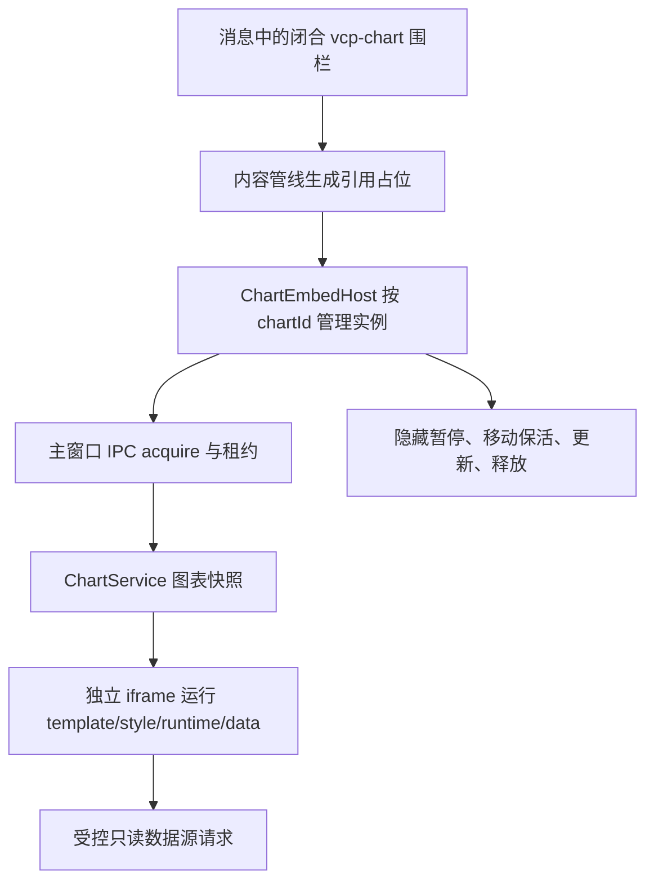

# 远端最新增量与图表嵌入

审计日期：2026-10-24（Asia/Shanghai）。本章补齐本地 VChat 尚未同步的生产源码，所有远端链接固定到提交，不跟随 main 漂移。

## 1. 三个快照必须分开

| 对象 | 固定快照 | 含义 |
|---|---|---|
| VCPMobile | `4c54cba3c3ac4eb90a309acc4b7e17e3354d27e4` | 本次移动端代码基线 |
| 本地 VChat | `60f87010ec306967472f6026ba03eec42852828e` | 本地合并提交，包含本地历史；01–06 主要审计对象 |
| 本地已同步的上游分支 | `8f1562ea8fb851d0e370449a66ba24700d93faf9` | `refs/remotes/origin/main`，2026-10-19 |
| 本次查询的远端 main | `2ba1af33a6d7f13a6d0597f9e1493521b51aecf8` | 2026-10-24 15:59:38，新增 v 图表 v2 |

GitHub 对后两者返回 ahead 53、behind 0、152 个净变更文件。**53 是两个上游快照之间的提交数，不是本地分支落后 53，也不是新增了 53 项渲染能力。** 本地合并 SHA 不能由公共 GitHub compare 解析，第一次以它为 base 的请求返回 404，随后改用已核实的上游基线。没有 fetch、pull 或修改 VChat checkout。

可复核证据：[上游比较](https://github.com/lioensky/VCPChat/compare/8f1562ea8fb851d0e370449a66ba24700d93faf9...2ba1af33a6d7f13a6d0597f9e1493521b51aecf8)、[提交与净变更清单](evidence/upstream-comparison.json)、[渲染相关净差异](evidence/upstream-rendering-diff.json)。本章只把最终生产源码仍存在的行为算作当前支持。

## 2. 2026-10-24：Mermaid 语法入口换用 Pele 1.9.0

提交 `c2481a9783820380f3f1b82719ba74fc95ac7157` 同时修改主聊天、Notes、Scriptorium 和文本阅读器。主窗口从 `vendor/mermaid.min.js` 切到 `vendor/pele.global.js`；新增 bundle 的文件头明确为 Pele 1.9.0。[提交差异](https://github.com/lioensky/VCPChat/commit/c2481a9783820380f3f1b82719ba74fc95ac7157)、[主窗口加载](https://github.com/lioensky/VCPChat/blob/2ba1af33a6d7f13a6d0597f9e1493521b51aecf8/main.html#L90)、[bundle](https://github.com/lioensky/VCPChat/blob/2ba1af33a6d7f13a6d0597f9e1493521b51aecf8/vendor/pele.global.js#L1)。

真实调用链仍是 Markdown 里的 `mermaid` / `flowchart` / `graph` 围栏 → Mermaid placeholder → `renderMermaidDiagrams` → `window.pele.render(originalCode)` → SVG → 原缩放/适应宽度工具栏。函数和 CSS 类中继续使用 Mermaid 名称，不代表仍调用 Mermaid 库。[主聊天入口，625–678 行](https://github.com/lioensky/VCPChat/blob/2ba1af33a6d7f13a6d0597f9e1493521b51aecf8/modules/messageRenderer.js#L625)。

当前包装层的实际行为：

- 同步一次性 `render`；每图源码超过 100,000 个 JS 字符时报错。字符上限不等于节点、布局时间或输出 SVG 大小预算。
- 逐图 try/catch，某一图失败不会直接阻止其它图处理；失败卡保留原始源码。
- 保留 SVG 上 Pele 内联的 CSS 变量映射，再设置缩放容器所需的尺寸；不能像旧代码一样删掉整个 `style` 属性。
- KaTeX 后处理跳过 `.mermaid` / `.mermaid-placeholder`，避免把图表源码先当正文数学改写。
- Notes 图色用 CSS 变量适配主题；Scriptorium 保留其稳定原子块身份，替换内部 SVG；阅读器有自己的容器、错误文本与缩放流程。

**这次替换没有在聊天入口调用 Pele 的增量 mount/update，也没有建立未闭合图表的“保留上次成功画面”状态机。** 它不是移动流式尾部引擎的替代品。Pele 包导出 parse/supports/mount 等接口，也不能推导 VChat 已接入了这些接口。当前入口调用 `render` 时未提供数学或图标 resolver；第三方库支持某选项，不代表聊天集成启用了它。

移动仍使用自身 Mermaid npm 依赖与 `mermaidRenderer.ts`，不能将远端变更记为移动已同步。既有 [Pele 隔离研究](../vcpmobile-pele-streaming-research/05-隔离运行实验与证据边界.md) 是任务开始前已存在的未跟踪资料，本次未修改、未重新执行，也不作为本次设备性能证据。若以后采用 Pele，应专门验证现有 Mermaid 语法、中文测量、主题、SVG 输出过滤、缩放导出及流式非法前缀，而非直接用桌面换库提交证明全面兼容。

源码中另有一个需复核的旁支：此次 Notes 修改把 KaTeX delimiters 第一项从 `$$/$$` 改成 `$/$` 且 `display:true`，后面仍保留 `$/$ display:false`。这是最终源码中可见的改变，但本次没有执行 Notes 运行样本，不能先认定为新能力或已证实故障；后续对齐时应独立核对，勿盲目复制。

## 3. 2026-10-24：v 图表 v2 真正进入消息正文

### 3.1 新语法与图表来源

新增语法是对**已存在图表资产的引用**：

````markdown
```vcp-chart
id: sales-trend
height: 360
title: 销售趋势
```
````

`id` 必填，匹配 `^[a-z0-9][a-z0-9_-]{1,63}$`，总长 2–64；height 默认 360，必须为 180–900 的整数；title 默认 id，截到 160 字符。只接受 id/height/title，重复或未知字段直接保留代码文本。必须闭合围栏，支持反引号和波浪号；普通代码域、内联代码、未闭合引用不转成图表。示例 ID 仅用于解释，未创建任何实际图表。[解析器 6–30 行](https://github.com/lioensky/VCPChat/blob/2ba1af33a6d7f13a6d0597f9e1493521b51aecf8/modules/chat/chartEmbedTransform.js#L6)。

它既不是 Mermaid 新语言，也不是把任意 `chart`/`echarts` fence 直接执行。实际内容来自 ChartService 的 snapshot：manifest、template、style、runtime、data。图表工作台已于 2026-09-18 的 `9be5b19e` 存在于本地；此次新增的是消息嵌入、实例与租约闭环，图表创建/编辑仍由原 Chart 工作台与 ChartController 负责。

### 3.2 调用与生命周期



消息渲染器在初始化创建 host；替换内容前 `beforeReplace` 暂存 iframe；内容装配后 `scan(contentDiv, {auto:processScripts})`；清空聊天时 clear，销毁 renderer 时 dispose。流式 `processScripts=false` 的扫描不自动创建图表实例，后续静态/终态扫描才允许自动；这不等于整个应用从不允许用户在流式期间手动点击播放。[接入点 2890、2914、3743、3782 行](https://github.com/lioensky/VCPChat/blob/2ba1af33a6d7f13a6d0597f9e1493521b51aecf8/modules/messageRenderer.js#L2890)。

当前 host 的具体约束：

| 机制 | 源码行为 |
|---|---|
| 同图复用 | 每个 renderer root 内按 chartId 一实例；重复引用默认选最后一个 eligible 槽位，点击播放可切换承载位置 |
| 实例配额 | 默认最多 4 个；满额先回收一个不可见实例，否则显示达到上限 |
| 移动保活 | 连接中的 iframe 使用 `Element.moveBefore` 移到停车区/新槽位，避免重新加载 |
| 不可见 | 根滚动范围外约 200px 或 document hidden 时 pause；可见时 resume、resize |
| 更新 | 同实例串行 refresh；codeRevision 改变重新 initialize，否则 data-change；generation 隔离旧消息 |
| 超时 | acquire 成功后、设置 iframe src 前启动 15 秒加载计时；不是整个 acquire 事务的总时限。没有引用的孤儿实例延迟 15 秒回收 |
| 操作 | 播放、打开工作台、复制引用；引用本身不是图表所有权或同步保证 |
| 卸载 | destroy、移除 iframe、release 租约、退订变化事件、释放 observers 和 message/visibility 监听 |

证据：[host 4–373 行](https://github.com/lioensky/VCPChat/blob/2ba1af33a6d7f13a6d0597f9e1493521b51aecf8/modules/renderer/chartEmbedHost.js#L4)。

### 3.3 执行边界与数据源

iframe 使用 `sandbox="allow-scripts"`、no-referrer，没有 `allow-same-origin`。新增 `vcp-chart://app` 协议只读固定的沙盒 HTML/JS 与 anime/Three/Pixi 资源路径，拒绝非 GET 或不在表内的资源。宿主按 `event.source`、chartId、generation 归属消息；主进程按主窗口 sender 和 token/chartId 配对租约，最大 32 个租约，页面导航/销毁时清理。[协议](https://github.com/lioensky/VCPChat/blob/2ba1af33a6d7f13a6d0597f9e1493521b51aecf8/modules/services/chartEmbedProtocol.js#L8)、[租约 IPC](https://github.com/lioensky/VCPChat/blob/2ba1af33a6d7f13a6d0597f9e1493521b51aecf8/modules/ipc/chartHandlers.js#L457)。

沙盒提供 resources、signal、requestRender，以及 JSON/text/CSV/SQLite/HTTP JSON 的数据读取桥。父页面把请求交到主进程，由 `chart:embed-read-data-source` handler 筛选允许字段后调用 ChartDataSourceService；不能把此接口理解为任意文件写入桥。实例销毁会清理沙盒受管资源并拒绝等待中的请求 Promise；本次未发现由租约释放向已开始的主进程读取传播 abort 的链路，因此不宣称实际 IO 已取消。[主进程字段筛选](https://github.com/lioensky/VCPChat/blob/2ba1af33a6d7f13a6d0597f9e1493521b51aecf8/modules/ipc/chartHandlers.js#L492)、[沙盒 context 与清理，475–533 行](https://github.com/lioensky/VCPChat/blob/2ba1af33a6d7f13a6d0597f9e1493521b51aecf8/Chartmodules/chart-sandbox.js#L475)。

### 3.4 对移动端意味着什么

移动目前无 `vcp-chart` 专用分派、ChartService 资产闭环或此租约通道。即使消息文本已同步，`id: sales-trend` 也不携带 template/style/runtime/data，更不携带桌面文件数据源；仅增加一个 Vue iframe 不能完成兼容。

另一个直接平台条件是 `moveBefore`。桌面 host 212 行明确要求它存在，否则只显示不支持与工作台入口。MDN 的兼容数据将 Chromium 起点列为 133，高于本项目 Chrome/WebView 117 最低基线；本次取得的 Safari 数据没有支持版本。应记录为“移动基线不能保证此原生 API”，不能照搬桌面条件后让大量手机失去功能，也不能用 `appendChild` 冒充无损保活。[API 的状态保持语义](https://developer.mozilla.org/en-US/docs/Web/API/Element/moveBefore)、[查询用兼容数据](https://github.com/mdn/browser-compat-data/blob/main/api/Element.json)。这份公共兼容表不是本项目 iOS 运行验证。

后续专题应先定资产如何到达手机、是否需要实时读取、离线时展示什么、多个引用是否必须共享活实例；再评估固定 iframe 承载位置/移动外壳等实现。这里的建议依据当前缺少的执行条件，不要求另建重复业务门禁，也不改变既定 Android/iOS 产品边界。

## 4. 同批仍然有效的其它呈现变化

### 4.1 上下文压缩 checkpoint 卡与审计徽章

10 月 22 日新增上下文压缩，后续添加标识符保真和未决项延续信息。最终 `isContextCheckpoint` 要求 role=user、`contextCompaction.kind='vchat-context-checkpoint'`、version=1、checkpoint 为字符串。消息被渲染为默认折叠 details，摘要展示历史条数/日记数/标识符保留比例/未决项比例，正文采用转义文本；普通内容高亮和 Pretext 跳过它。[识别协议](https://github.com/lioensky/VCPChat/blob/2ba1af33a6d7f13a6d0597f9e1493521b51aecf8/modules/chat/contextCompactionState.js#L6)、[卡片渲染 2032–2070 行](https://github.com/lioensky/VCPChat/blob/2ba1af33a6d7f13a6d0597f9e1493521b51aecf8/modules/messageRenderer.js#L2032)。

这和移动已有 SummaryBlock 不同：前者靠结构化消息元数据识别，并改变后续请求采用的上下文起点；后者不能仅因名称相近视为同一能力。移动 `MessageSyncDTO`（`src-tauri/src/vcp_modules/sync/sync_dto.rs:163`）列举的字段不含 contextCompaction，也没有泛型 metadata 承载；当前至少不能保留该卡片身份。完整同步去留及上下文语义需要另沿双方 canonical/hash/数据库核查，本次不宣称所有内容会丢失。

### 4.2 后台流帧与回前台追平

`69a5ed05` 移除桌面全局关闭 Chromium 后台节流的办法；streamManager 根据 visibility 在 rAF 与 timer 之间切换，隐藏或回前台最初 100ms 排空当前积压。timer 的设置值约 33ms，不是后台实际 30fps 保证，源码也承认浏览器节流。[最终代码 235–312 行](https://github.com/lioensky/VCPChat/blob/2ba1af33a6d7f13a6d0597f9e1493521b51aecf8/modules/renderer/streamManager.js#L235)。

移动 Rust 后台生成、持久化、恢复与 TailFrame 序号已有独立 owner，不能移植 Electron timer 作为原生后台能力。可借鉴的是“恢复时追当前结果，不重播长时间积压动画”的交互目标。

### 4.3 工具气泡变为弱装饰默认

最终 `styles/messageRenderer.css:81` 起对未采用专门呈现样式的工具请求/结果/摘要气泡使用薄边、浅底、无 backdrop-filter、无持续 animation；状态文本还移除了重复装饰符号。这比本地旧截图或旧 CSS 更接近移动的高密度极简原则。[最终样式](https://github.com/lioensky/VCPChat/blob/2ba1af33a6d7f13a6d0597f9e1493521b51aecf8/styles/messageRenderer.css#L81)。

特别纠偏：历史 `47075f78` 曾增加 full/steady/once 气泡流光设置，**但最终 appearance-engine、appearance-settings 和 messageRenderer.css 中已没有该设置或 gate 消费**。不能把中间提交的功能写进“今日新增待移植清单”。五种工具布局及展开策略仍存在；流光模式是另一回事。

### 4.4 审批通知的 PowerShell 摘要

`3f4885a9` 为 PowerShellExecutor 的 powershell/powershellN、ServerPowerShellExecutor 的 command 提取命令头，规范空白，最多显示 240 字符加省略号，用 textContent 写入。它不执行脚本、不改变审批参数，也不替代正文完整脚本。[最终入口 616–658 行](https://github.com/lioensky/VCPChat/blob/2ba1af33a6d7f13a6d0597f9e1493521b51aecf8/modules/notificationRenderer.js#L616)。移动已有批准/拒绝/理由，这里属于信息预览补齐，不是“移动没有审批”。

### 4.5 其它相关净变化

- `readToolRequestField` 新增 `{trim:false}`，供需要保留首尾空白的日记提取使用；应按调用者语义选择，不全局删除 trim。
- 上下文压缩入口带运行中停止/错误反馈；这是领域业务与渲染结合，不能只复制一张卡片。
- 外观工作台改为侧栏页、默认/极简预设、Messenger 纯色气泡、无自定义头像的群组拼图；属于宿主布局/主题功能，不是新增 Markdown 语法。
- ProjectForge、音乐 DSP、终端修复、同步空目录修复也位于这 53 个提交内，不因同批出现而纳入消息渲染核心移植。

## 5. 证据边界

本章执行了远端 HEAD 查询、公共 GitHub API compare、固定提交源码读取和兼容资料核对。没有运行远端 Electron，没有在本机更新桌面程序，没有构建移动端，没有获取 Android/iOS 设备证据。上游提交描述中的“测试通过”不算本次执行结果。所有接入建议均未授权为实现任务；具体优先顺序见 [08](08-接入优先级与后续工作包.md)。
