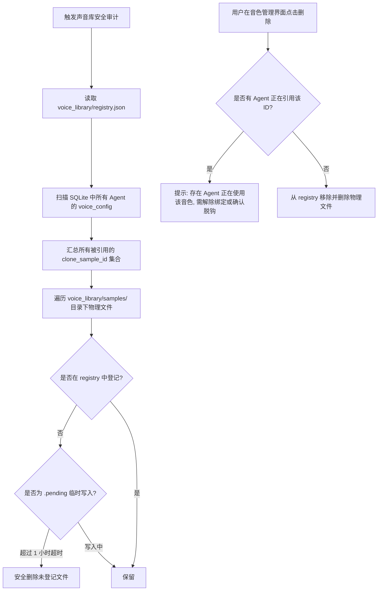

# 01-双端存储与声音模型库架构设计

> 本文档设计移动端（Android / iOS）本地声音模型库沙盒架构，彻底废除全局单样本误删逻辑，建立基于注册表的物理存储与引用保护机制。

> **初稿条款已调整**：不做旧库迁移；取消引用计数、被引用拒删与级联解绑，删除后失效引用解析为“无”；完全删除 `refText`。以 [05-实施决策与验证记录](05-实施决策与验证记录.md) 及生产代码为准。

---

## 1. 移动双端本地沙盒物理目录规范

在 Android 与 iOS 设备本地，声音模型库脱离原先不可靠的临时单点目录，迁移到专用的应用数据持久化目录：

```text
[移动端应用数据根目录: app_data_dir/voice_library/]
│
├── registry.json                 # 声音模型注册表 (JSON 索引文件)
│
└── samples/                      # 音频物理文件存储目录 (CAS 哈希或稳定 UUID)
    ├── 4e9ac12f5a8c9b10...wav    # 音频原声数据
    ├── 8b11e45a77c3d201...mp3
    └── ...
```

### 双端路径解析
* **统一 Rust 路径解析入口**：
  ```rust
  pub fn voice_library_root<R: Runtime>(app: &AppHandle<R>) -> Result<PathBuf, String> {
      let root = app.path().app_data_dir().map_err(|e| e.to_string())?.join("voice_library");
      Ok(root)
  }
  ```
* **Android 原生映射**：`/data/user/0/com.vcp.avatar/files/voice_library/`
* **iOS 原生映射**：`<Application_Home>/Documents/voice_library/`

---

## 2. 声音资产注册表契约 (Registry Architecture)

`registry.json` 作为本地克隆声音资产的唯一权威登记册，记录每个声音模型的元数据：

```json
{
  "version": 1,
  "samples": [
    {
      "id": "sample_7a8b9c1d2e3f4051",
      "name": "晴雪",
      "fileName": "qingxue_sample.wav",
      "format": "wav",
      "fileBytes": 786432,
      "durationMs": 8200,
      "fileHash": "4e9ac12f5a8c9b1093f8e02d...",
      "refText": "今天天气格外晴朗，我们继续推进刚才讨论的方案吧。",
      "createdAt": 1729800000000,
      "updatedAt": 1729800000000
    }
  ]
}
```

### 资产字段定义
| 字段名 | 类型 | 说明 |
| :--- | :--- | :--- |
| `id` | `String` (32 hex / UUID) | 唯一资产句柄，作为 Agent 配置绑定的引用键 |
| `name` | `String` | 用户命名的音色模型名称（如“晴雪”、“智者”） |
| `fileName` | `String` | 原始上传文件名 |
| `format` | `"mp3" \| "wav"` | 音频封装格式（只支持标准 MP3 与 PCM WAV） |
| `fileBytes` | `u64` | 物理文件字节大小（上限 7,000,000 字节，即 7 MB） |
| `durationMs` | `u32` | 音频时长（毫秒，解析头部元数据得出） |
| `fileHash` | `String` (SHA-256) | 音频物理文件的哈希摘要，用于防重与内容完整性校验 |
| `refText` | `Option<String>` | 录入的 Prompt 参考转写文本，辅助 TTS 模型发音对齐 |

---

## 3. 彻底重构孤儿清理机制：引用计数安全 GC (Reference Counting GC)

废除原先按全局单个 `selected_sample_id` 进行强制删除的暴力清理逻辑。引入**基于 Agent 引用计数的安全垃圾回收机制**：



### 关键代码改造准则
1. 在 `src-tauri/src/vcp_modules/chat/voice_service/samples.rs` 中：
   * 将 `selected_sample_id(snapshot)` 重写为 `referenced_sample_ids(app)`，通过读取 SQLite 中所有未删除的 Agent 的 `clone_sample_id`，构成合法引用白名单；
   * 严禁无差别删除任何在 `registry.json` 中已注册的声音资产！

---

## 4. 音频文件校验与防御性处理 (Defensive IO)

双端在导入用户音频文件时，必须严格通过以下防御性门禁：
1. **尺寸上限拦截**：严格限制 `bytes <= 7,000,000`（7 MB），超限直接拒绝，防爆内存；
2. **格式物理探测**：
   * WAV：校验前 12 字节的 `RIFF` 与 `WAVE` 标识，并解析 `fmt ` 块采样率；
   * MP3：校验 SyncWord `0xFFE0`，拦截损坏的伪装文件；
3. **临时文件原子落盘**：
   * 导入时先写入 `samples/.pending-<id>` 临时文件；
   * 计算 SHA-256 并验证成功后，通过 `tokio::fs::rename` 原子重命名为 `<id>` 并同步更新 `registry.json`，确保断电或崩溃不会产生损坏脏数据。
