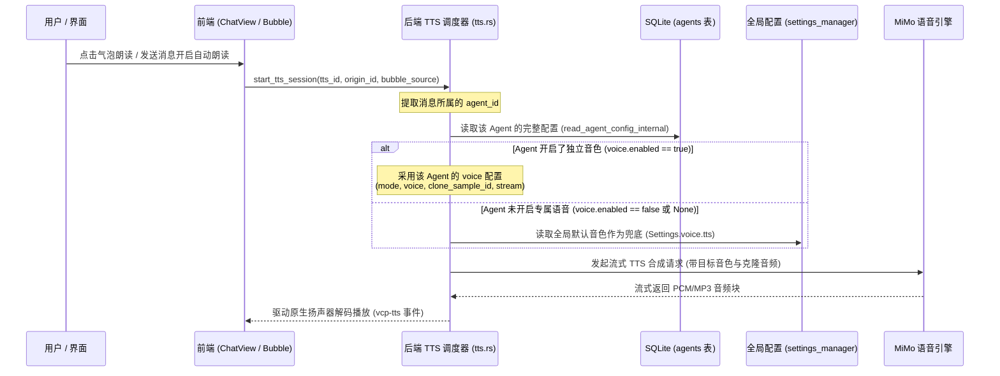

# 04-全链路TTS朗读调度与闭环验证

> 本文档规范后端 TTS 调度器对 Agent 专属音色的动态注入逻辑，以及端到端验证标准。

> **调度以实施稿为准**：按真实消息作者冻结音色，群聊“无”成员跳过并继续其他成员；手动朗读“无”明确报错，删除不级联解绑。以下示意中的全局先加载样本和吞错回退不适用。最终证据见 [05-实施决策与验证记录](05-实施决策与验证记录.md)。

---

## 1. 全链路 TTS 朗读调度重构 (Narration Dispatcher)

### 1.1 现状与改造目标
* **原链路**：`start_narration` 仅读取全局 Settings，导致所有朗读声音相同；
* **新链路**：`start_narration` 接收或解析目标消息所属的 `agent_id`，按层级解析生效配置：



### 1.2 调度层代码改造点 (`src-tauri/src/vcp_modules/chat/voice_service/tts.rs`)
在 `prepare_narration` 中引入双源决策：
```rust
pub(super) async fn prepare_narration_for_owner<R: Runtime>(
    app: &AppHandle<R>,
    owner_id: Option<&str>,
    cancel: &CancellationToken,
) -> Result<PreparedNarration, String> {
    // 1. 获取基础网络凭据 (连接 API Key/BaseUrl 始终取全局连接设置)
    let global_snapshot = samples::snapshot_voice_settings(app, cancel).await?;
    let connection = global_snapshot.settings.voice.connection.clone();

    // 2. 检查是否有 Agent 级别的音色配置
    let mut effective_tts = global_snapshot.settings.voice.tts.clone();
    if let Some(agent_id) = owner_id {
        let agent_state = app.state::<crate::vcp_modules::agent::AgentConfigState>();
        if let Ok(agent_cfg) = crate::vcp_modules::agent::read_agent_config_internal(app, &agent_state, agent_id, Some(false)).await {
            if let Some(voice_cfg) = agent_cfg.voice.filter(|v| v.enabled) {
                effective_tts.mode = match voice_cfg.mode {
                    AgentVoiceMode::Builtin => VoiceTtsMode::Builtin,
                    AgentVoiceMode::Clone => VoiceTtsMode::Clone,
                };
                effective_tts.voice = voice_cfg.voice;
                effective_tts.clone_sample_id = voice_cfg.clone_sample_id;
                effective_tts.stream = voice_cfg.stream;
            }
        }
    }

    // 3. 构建当前朗读的独立策略，并加载克隆音频
    let policy = Arc::new(VoiceReplyPolicy::from_custom(connection, effective_tts));
    let sample = if policy.config.tts_mode == VoiceTtsMode::Clone && policy.config.configured() {
        samples::prepare_clone_sample(app, &policy.config.clone_sample_id, cancel).await.map(Some)?
    } else {
        None
    };

    Ok(PreparedNarration { policy, sample: Ok(sample) })
}
```

---

## 2. 验证与验收标准 (Acceptance Criteria)

### AC 1: 静态检查与契约完整性
* [ ] 执行 `pnpm check`，TypeScript 类型检查无报错；
* [ ] ESLint 检查 0 warnings；
* [ ] Cargo workspace `cargo check --locked` 编译通过。

### AC 2: 独立音色与全局继承闭环
* [ ] **未开启独立音色**：新建 Agent 后默认 `enabled: false`，朗读该 Agent 消息时自动使用全局设置中配置的默认音色；
* [ ] **预置音色独立生效**：将 Agent A 设置为“冰糖”，Agent B 设置为“苏打”，分别触发两者的气泡朗读，各自发音符合预期，且全局设置中的音色未被篡改；
* [ ] **克隆音色独立生效**：为 Agent C 上传专属克隆声音“晴雪”，触发朗读时准确加载“晴雪”的参考音频，且不影响其他 Agent。

### AC 3: 声音模型库安全与防误删
* [ ] 用户在音色管理界面导入 3 个不同的克隆音频后，重启应用或触发语音对话，3 个音频依然完好存在于本地库中，**严禁发生任何未授权物理删除**；
* [ ] 删除某音色时，若有 Agent 正在绑定，提供明确的脱钩提示。

### AC 4: Agent 设置界面排版与原有逻辑完整度
* [ ] 遵循方案 D 微层阶台面式，外置章节头纯净简洁，无无效修饰标签；
* [ ] 模型名称、`ModelSelector` 按钮、Temperature 输入框及其与 `useTemperature` 的联动、上下文 Token、最大输出 Token、流式输出、发送温度参数 100% 正常工作；
* [ ] 删除 Agent 按钮与拦截逻辑 100% 保持原有表现。
